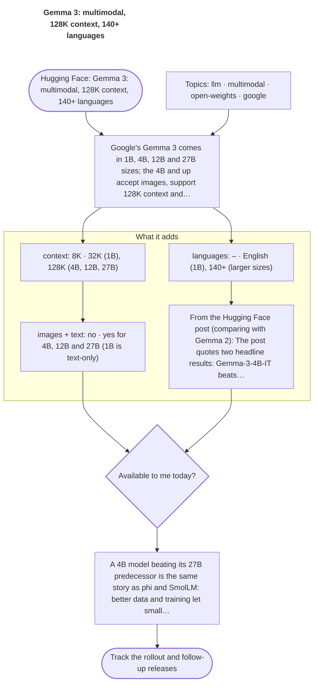

## What happened

**Google** released **Gemma 3**, with base and instruction-tuned models on the Hub and Hugging Face integration.

## The technical details

From the Hugging Face post (comparing with Gemma 2):

| | Gemma 2 | Gemma 3 |
|---|---|---|
| sizes | 2B, 9B, 27B | **1B, 4B, 12B, 27B** |
| context | 8K | **32K** (1B), **128K** (4B, 12B, 27B) |
| images + text | no | **yes** for 4B, 12B and 27B (1B is text-only) |
| languages | – | English (1B), **140+** (larger sizes) |

The post quotes two headline results: **Gemma-3-4B-IT beats Gemma-2-27B-IT**, and **Gemma-3-27B-IT beats Gemini 1.5-Pro** across benchmarks.

## How it fits together

The flowchart below maps this announcement's main points and what depends on them.

## Why it matters

A 4B model beating its 27B predecessor is the same story as phi and SmolLM: better data and training let small models catch up fast.
