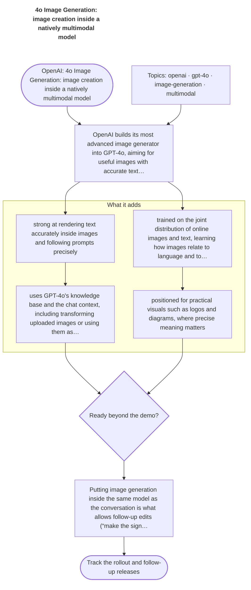

## What happened

On 25 March 2025 **OpenAI** introduced **4o Image Generation**, built into GPT-4o as a natively multimodal model. The post argues that image generation should be a primary capability of language models and that its goal is images that are useful, not only beautiful.

## The technical details

From the OpenAI post:

- strong at **rendering text accurately** inside images and **following prompts precisely**
- uses **GPT-4o's knowledge base and the chat context**, including transforming uploaded images or using them as inspiration
- trained on the **joint distribution of online images and text**, learning how images relate to language and to each other, combined with aggressive post-training
- positioned for practical visuals such as logos and diagrams, where precise meaning matters

## How it fits together

The flowchart below maps this announcement's main points and what depends on them.

## Why it matters

Putting image generation inside the same model as the conversation is what allows follow-up edits (“make the sign say…”) to keep context. The emphasis on text and diagrams reflects that earlier generators were better at scenes than at the symbols people actually need in work documents.
