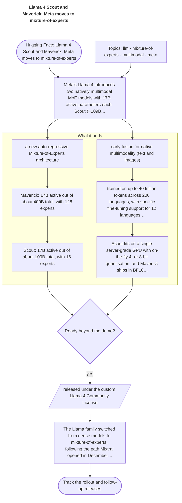

## What happened

**Meta** released **Llama 4 Scout** and **Llama 4 Maverick**, with day-one support in Transformers and TGI.

## The technical details

From the Hugging Face post:

- a new **auto-regressive Mixture-of-Experts** architecture
- **Maverick**: 17B active out of about **400B** total, with **128 experts**
- **Scout**: 17B active out of about **109B** total, with **16 experts**
- **early fusion** for native multimodality (text and images)
- trained on up to **40 trillion tokens** across **200 languages**, with specific fine-tuning support for 12 languages including Hindi
- **Scout** fits on a **single server-grade GPU** with on-the-fly 4- or 8-bit quantisation, and **Maverick** ships in BF16 and FP8
- released under the custom **Llama 4 Community License**

## How it fits together

The flowchart below maps this announcement's main points and what depends on them.

## Why it matters

The Llama family switched from dense models to mixture-of-experts, following the path Mixtral opened in December 2023. "Early fusion" is the same design idea as the Chameleon paper (summarised here in May 2024).
