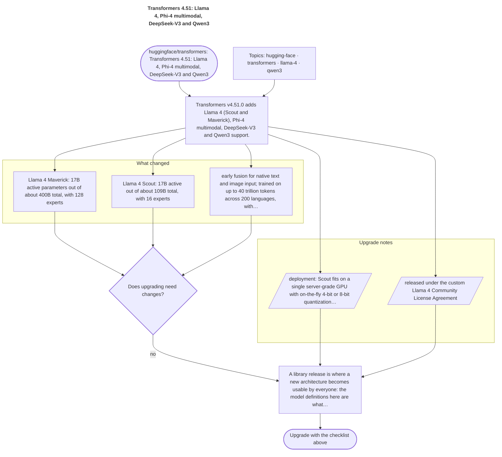

## What happened

On 5 April 2025 **Hugging Face** released **Transformers v4.51.0**, led by support for Meta's **Llama 4** and also adding **Phi-4 multimodal**, **DeepSeek-V3** and **Qwen3**.

## The technical details

From the release notes:

- **Llama 4 Maverick:** 17B active parameters out of about 400B total, with 128 experts
- **Llama 4 Scout:** 17B active out of about 109B total, with 16 experts
- **early fusion** for native text and image input; trained on up to **40 trillion tokens** across **200 languages**, with fine-tuning support for 12 languages including Arabic, Spanish, German and Hindi
- **deployment:** Scout fits on a single server-grade GPU with on-the-fly 4-bit or 8-bit quantization; Maverick is available in BF16 and FP8
- released under the custom **Llama 4 Community License Agreement**

## How it fits together

The flowchart below maps this announcement's main points and what depends on them.

## Why it matters

A library release is where a new architecture becomes usable by everyone: the model definitions here are what vLLM, llama.cpp and fine-tuning tools build on. This blog's separate post covers Llama 4 itself.
