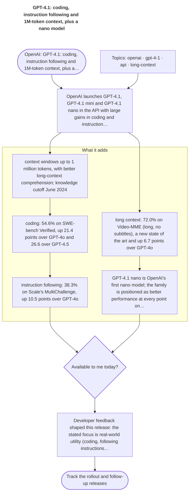

## What happened

On 14 April 2025 **OpenAI** launched three models in the API: **GPT-4.1**, **GPT-4.1 mini** and **GPT-4.1 nano**. They outperform GPT-4o and GPT-4o mini across the board, with major gains in coding and instruction following.

## The technical details

From the OpenAI post:

- context windows up to **1 million tokens**, with better long-context comprehension; knowledge cutoff **June 2024**
- **coding:** 54.6% on **SWE-bench Verified**, up 21.4 points over GPT-4o and 26.6 over GPT-4.5
- **instruction following:** 38.3% on Scale's **MultiChallenge**, up 10.5 points over GPT-4o
- **long context:** 72.0% on **Video-MME** (long, no subtitles), a new state of the art and up 6.7 points over GPT-4o
- GPT-4.1 **nano** is OpenAI's first nano model; the family is positioned as better performance at every point on the latency and cost curve

## How it fits together

The flowchart below maps this announcement's main points and what depends on them.

## Why it matters

Developer feedback shaped this release: the stated focus is real-world utility (coding, following instructions, using long context) rather than chat polish. A 1M-token window with improved retrieval is what makes whole-repository tasks practical.
