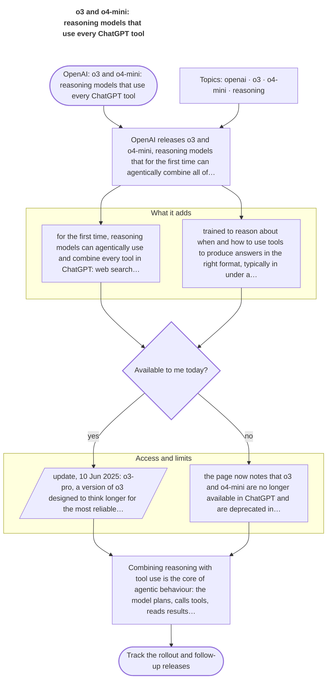

## What happened

On 16 April 2025 **OpenAI** released **o3** and **o4-mini**, the latest in its o-series of models trained to think for longer before responding, describing them as its smartest models to date.

## The technical details

From the OpenAI post:

- for the first time, reasoning models can **agentically use and combine every tool in ChatGPT**: web search, analyzing uploaded files and data with Python, reasoning about visual inputs, and generating images
- trained to reason about **when and how to use tools** to produce answers in the right format, typically in under a minute
- **update, 10 Jun 2025:** **o3-pro**, a version of o3 designed to think longer for the most reliable answers, is available to Pro users and in the API
- the page now notes that o3 and o4-mini are no longer available in ChatGPT and are deprecated in the API

## How it fits together

The flowchart below maps this announcement's main points and what depends on them.

## Why it matters

Combining reasoning with tool use is the core of agentic behaviour: the model plans, calls tools, reads results and continues. The post presents this as a step toward a ChatGPT that can independently execute tasks.
