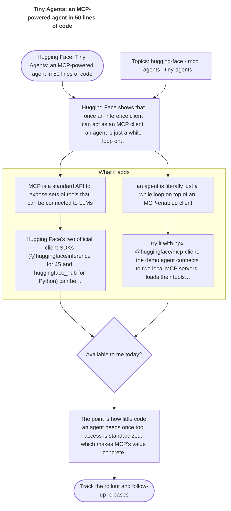

## What happened

On 25 April 2025 a **Hugging Face** engineer published **Tiny Agents**, a walkthrough of building an agent powered by the **Model Context Protocol (MCP)** in about 50 lines of TypeScript.

## The technical details

From the Hugging Face post:

- MCP is a **standard API to expose sets of tools** that can be connected to LLMs
- Hugging Face's two official client SDKs (`@huggingface/inference` for JS and `huggingface_hub` for Python) can be extended to act as **MCP clients** and feed MCP server tools into LLM inference
- **an agent is literally just a while loop** on top of an MCP-enabled client
- try it with `npx @huggingface/mcp-client`: the demo agent connects to two local MCP servers, loads their tools and prompts you for a conversation

## How it fits together

The flowchart below maps this announcement's main points and what depends on them.

## Why it matters

The point is how little code an agent needs once tool access is standardized, which makes MCP's value concrete. It is a good companion to this blog's post on Anthropic open-sourcing the protocol.
