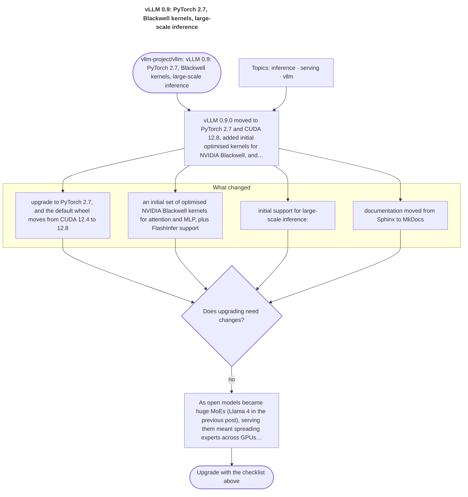

## What happened

**vLLM v0.9.0** was released, with **649 commits** from **215 contributors** (82 new).

## The technical details

From the release notes:

- upgrade to **PyTorch 2.7**, and the default wheel moves from **CUDA 12.4 to 12.8**
- an initial set of **optimised NVIDIA Blackwell kernels** for attention and MLP, plus FlashInfer support
- initial support for large-scale inference:
  - **EP** (expert parallelism): MoE permute/unpermute kernels and an all-to-all interface
  - **DP** (data parallelism): engine process management decoupled from communication
  - **PD** (prefill/decode disaggregation): NIXL integration and multiple KV connectors
- documentation moved from Sphinx to MkDocs

## How it fits together

The flowchart below maps this announcement's main points and what depends on them.

## Why it matters

As open models became huge MoEs (Llama 4 in the previous post), serving them meant spreading experts across GPUs and separating the prompt-processing (prefill) phase from token generation (decode). This release lays that groundwork.
