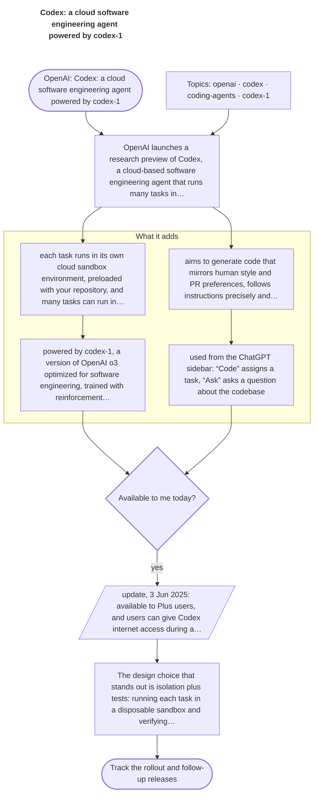

## What happened

On 16 May 2025 **OpenAI** launched a research preview of **Codex**, available first to ChatGPT Pro, Business and Enterprise users, with Plus and Edu to follow. It can write features, answer questions about a codebase, fix bugs and propose pull requests for review.

## The technical details

From the OpenAI post:

- each task runs in its **own cloud sandbox environment**, preloaded with your repository, and many tasks can run **in parallel**
- powered by **codex-1**, a version of **OpenAI o3** optimized for software engineering, trained with **reinforcement learning on real-world coding tasks**
- aims to generate code that mirrors human style and PR preferences, follows instructions precisely and **iteratively runs tests until it gets a passing result**
- used from the ChatGPT sidebar: “Code” assigns a task, “Ask” asks a question about the codebase
- **update, 3 Jun 2025:** available to Plus users, and users can give Codex internet access during a task; the page now marks the launch post as outdated

## How it fits together

The flowchart below maps this announcement's main points and what depends on them.

## Why it matters

The design choice that stands out is isolation plus tests: running each task in a disposable sandbox and verifying with the repository's own tests turns code generation into something a reviewer can check. This is the origin of the Codex product that dominates the feed through 2026.
