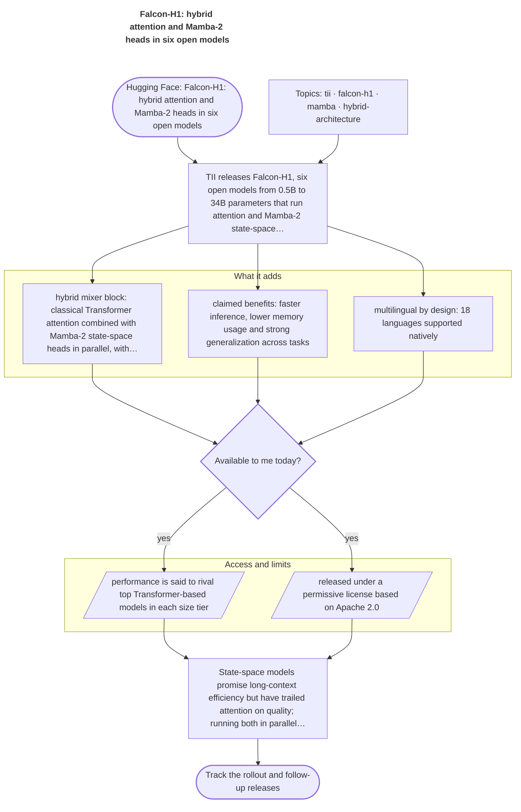

## What happened

On 21 May 2025 the Technology Innovation Institute introduced the **Falcon-H1** series through **Hugging Face**: six open-weight models in 0.5B, 1.5B, 1.5B-Deep, 3B, 7B and 34B sizes, each with base and instruction-tuned variants.

## The technical details

From the Hugging Face post:

- **hybrid mixer block:** classical **Transformer attention** combined with **Mamba-2** state-space heads **in parallel**, with the number of each adjustable independently
- claimed benefits: **faster inference, lower memory usage** and strong generalization across tasks
- performance is said to rival top Transformer-based models in each size tier
- **multilingual by design**: 18 languages supported natively
- released under a permissive license based on **Apache 2.0**

## How it fits together

The flowchart below maps this announcement's main points and what depends on them.

## Why it matters

State-space models promise long-context efficiency but have trailed attention on quality; running both in parallel and tuning the ratio is a practical way to get both. Falcon-H1 is an example of hybrid models moving from research into open releases.
