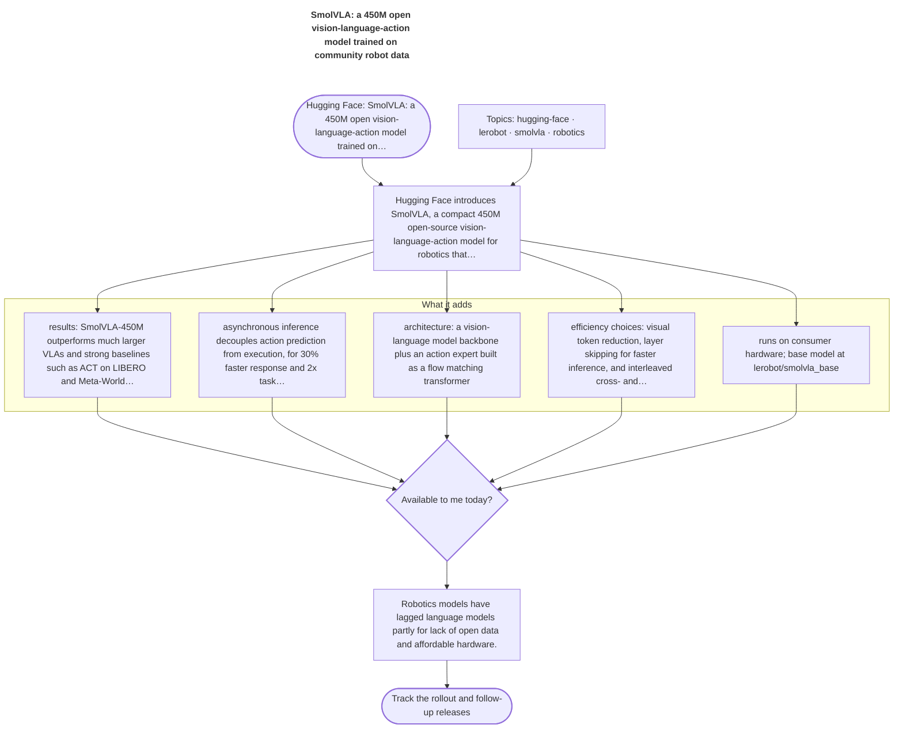

## What happened

On 3 June 2025 **Hugging Face** introduced **SmolVLA**, a compact (450M) open-source vision-language-action model for robotics. It was pretrained only on compatibly licensed, open-source community datasets shared under the **lerobot** tag.

## The technical details

From the Hugging Face post:

- **results:** SmolVLA-450M outperforms much larger VLAs and strong baselines such as **ACT** on **LIBERO** and **Meta-World** simulation and on real-world **SO100/SO101** tasks
- **asynchronous inference** decouples action prediction from execution, for **30% faster response and 2x task throughput**
- **architecture:** a vision-language model backbone plus an **action expert** built as a **flow matching transformer**
- efficiency choices: **visual token reduction**, **layer skipping** for faster inference, and **interleaved cross- and self-attention**
- runs on consumer hardware; base model at `lerobot/smolvla_base`

## How it fits together

The flowchart below maps this announcement's main points and what depends on them.

## Why it matters

Robotics models have lagged language models partly for lack of open data and affordable hardware. SmolVLA's pitch is that a small model trained on community-shared recordings can beat larger ones, so the dataset effort matters as much as the model.
