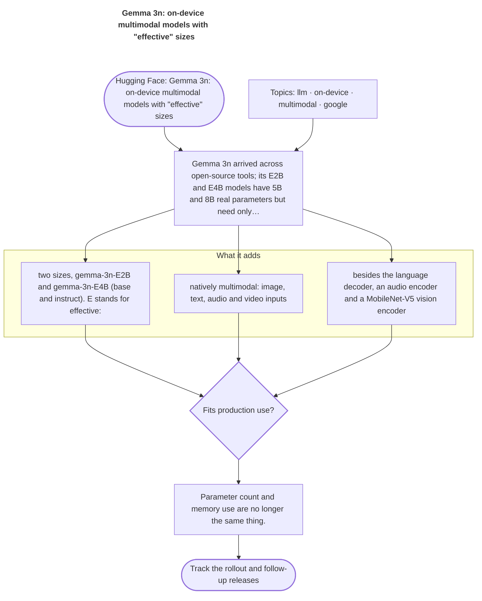

## What happened

**Gemma 3n**, previewed at Google I/O, became available across the main open-source tools: Transformers, timm, MLX, llama.cpp (text), transformers.js, Ollama and Google AI Edge.

## The technical details

From the post:

- two sizes, **`gemma-3n-E2B`** and **`gemma-3n-E4B`** (base and instruct). **E** stands for **effective**:
  - real parameter counts are **5B** and **8B**
  - thanks to memory-efficiency techniques, they need only about **2B / 4B** of VRAM, and run in about **2GB** and **3GB** of GPU RAM
- natively multimodal: **image, text, audio and video** inputs
- besides the language decoder, an **audio encoder** and a **MobileNet-V5** vision encoder

## How it fits together

The flowchart below maps this announcement's main points and what depends on them.

## Why it matters

Parameter count and memory use are no longer the same thing. Models can now be designed specifically for phones and laptops, and the Gemma 4 posts later this year continue that line.
