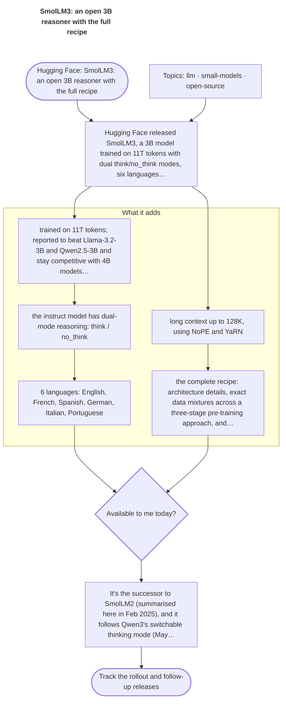

## What happened

Hugging Face released **SmolLM3**, a fully open **3B** model, with base and instruct/reasoning checkpoints.

## The technical details

From the post:

- trained on **11T tokens**; reported to beat **Llama-3.2-3B** and **Qwen2.5-3B** and stay competitive with 4B models (Qwen3, Gemma3)
- the instruct model has **dual-mode reasoning**: `think` / `no_think`
- **6 languages**: English, French, Spanish, German, Italian, Portuguese
- **long context up to 128K**, using **NoPE** and **YaRN**
- the **complete recipe**: architecture details, exact data mixtures across a **three-stage pre-training** approach, and how the hybrid reasoning model was built

## How it fits together

The flowchart below maps this announcement's main points and what depends on them.

## Why it matters

It's the successor to SmolLM2 (summarised here in Feb 2025), and it follows Qwen3's switchable thinking mode (May 2025) at a much smaller size. The published recipe makes it a useful reference for anyone training small models.
