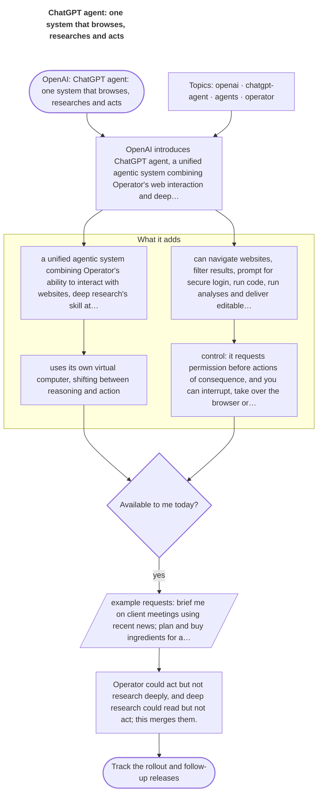

## What happened

On 17 July 2025 **OpenAI** introduced **ChatGPT agent**: ChatGPT can now do work for you using its own computer, handling complex tasks from start to finish. Pro, Plus and Team users could activate it from the tools dropdown by selecting “agent mode”.

## The technical details

From the OpenAI post:

- a **unified agentic system** combining Operator's ability to interact with websites, deep research's skill at synthesizing information, and ChatGPT's conversational fluency
- uses its **own virtual computer**, shifting between reasoning and action
- can navigate websites, filter results, prompt for secure login, **run code**, run analyses and deliver **editable slideshows and spreadsheets**
- example requests: brief me on client meetings using recent news; plan and buy ingredients for a Japanese breakfast for four; analyze three competitors and create a slide deck
- **control:** it requests permission before actions of consequence, and you can interrupt, take over the browser or stop at any point

## How it fits together

The flowchart below maps this announcement's main points and what depends on them.

## Why it matters

Operator could act but not research deeply, and deep research could read but not act; this merges them. The human-in-the-loop controls in the post (permission requests, takeover) are central to how such an agent is meant to be trusted.
