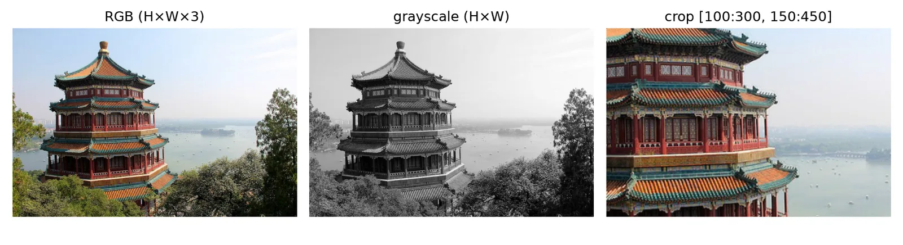

Phase 10, computer vision, starts with what an image actually is: an array.

- Shape **H × W × C**: height, width, channels (3 for RGB, 1 for grayscale).
- Values are usually **uint8 in [0, 255]**. Models want floats, typically in [0, 1] or standardised.
- Grayscale is a weighted sum of the channels. The common ITU-R BT.601 weights are 0.299 R + 0.587 G + 0.114 B.
- **Layout trap**: NumPy, PIL and Matplotlib use channels-last (H × W × C). PyTorch uses channels-first (C × H × W), and OpenCV loads colour as **BGR**.
- **Overflow trap**: adding two uint8 values wraps around past 255. Convert to float first.

The sample photo ships with scikit-learn (`china.jpg`), so no download is needed.

```python run
import os
import numpy as np
import matplotlib.pyplot as plt
import torch
from sklearn.datasets import load_sample_image

img = load_sample_image("china.jpg")
print("shape", img.shape, "dtype", img.dtype, "range", img.min(), img.max())

gray = (0.299 * img[..., 0] + 0.587 * img[..., 1] + 0.114 * img[..., 2]).astype(np.uint8)
crop = img[100:300, 150:450]
print("gray", gray.shape, "crop", crop.shape, "mean RGB", img.reshape(-1, 3).mean(0).round(1))

print("uint8 overflow: 200 + 100 =", (np.array([200], np.uint8) + np.array([100], np.uint8))[0])
t = torch.from_numpy(img).permute(2, 0, 1).float() / 255
print("torch tensor", tuple(t.shape), "range", round(t.min().item(), 2), round(t.max().item(), 2))

fig, axs = plt.subplots(1, 3, figsize=(11, 3), dpi=150)
for ax, im, title in zip(axs, [img, gray, crop], ["RGB (H×W×3)", "grayscale (H×W)", "crop [100:300, 150:450]"]):
    ax.imshow(im, cmap="gray" if im.ndim == 2 else None); ax.set_title(title); ax.axis("off")
fig.tight_layout(); fig.savefig(os.environ["SNIPPET_FIG"])
```

Output:

```text
shape (427, 640, 3) dtype uint8 range 0 255
gray (427, 640) crop (200, 300, 3) mean RGB [144.7 145.5 140.9]
uint8 overflow: 200 + 100 = 44
torch tensor (3, 427, 640) range 0.0 1.0
```



The photo is the `china.jpg` sample image bundled with scikit-learn.
