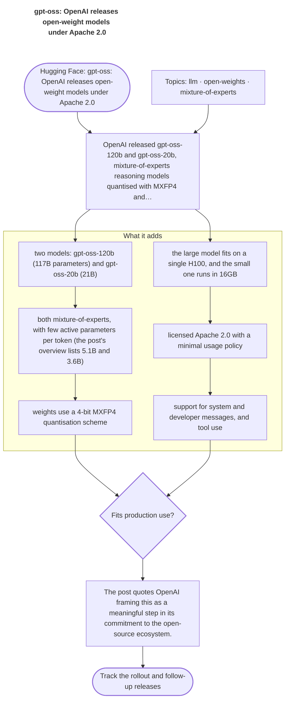

## What happened

**OpenAI** released **GPT OSS**, open-weight models designed for reasoning, agentic tasks and developer use, with day-one Hugging Face support (Transformers with Flash Attention 3, llama.cpp, vLLM, `transformers serve` and cloud partners).

## The technical details

From the Hugging Face post:

- two models: **gpt-oss-120b** (117B parameters) and **gpt-oss-20b** (21B)
- both **mixture-of-experts**, with few active parameters per token (the post's overview lists 5.1B and 3.6B)
- weights use a **4-bit MXFP4** quantisation scheme
- the large model **fits on a single H100**, and the small one **runs in 16GB**
- licensed **Apache 2.0** with a minimal usage policy
- support for system and developer messages, and tool use

## How it fits together

The flowchart below maps this announcement's main points and what depends on them.

## Why it matters

The post quotes OpenAI framing this as a meaningful step in its commitment to the open-source ecosystem. Technically, shipping weights already in a 4-bit format shows how standard quantisation (my March 2026 study notes) has become for open models.
