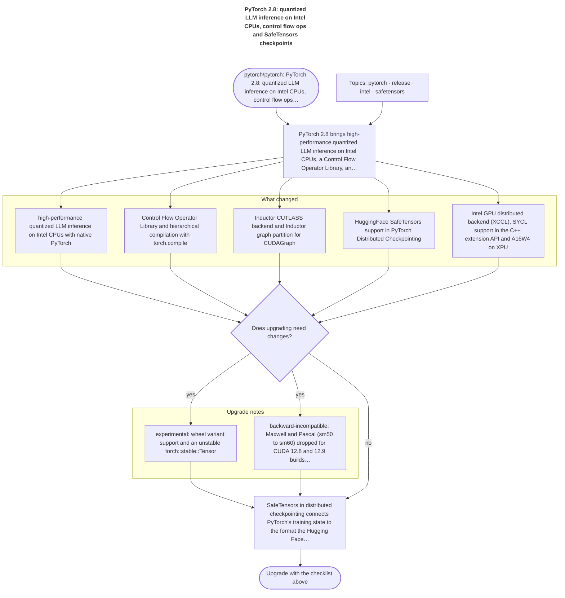

## What happened

On 6 August 2025 the **PyTorch** team released **2.8.0**. The release notes list the highlights below, with details in a separate release blog post.

## The technical details

From the release notes:

- **high-performance quantized LLM inference on Intel CPUs** with native PyTorch
- **Control Flow Operator Library** and **hierarchical compilation** with `torch.compile`
- **Inductor CUTLASS backend** and **Inductor graph partition for CUDAGraph**
- **HuggingFace SafeTensors support** in PyTorch Distributed Checkpointing
- **Intel GPU** distributed backend (XCCL), SYCL support in the C++ extension API and A16W4 on XPU
- experimental: **wheel variant support** and an unstable `torch::stable::Tensor`
- backward-incompatible: **Maxwell and Pascal (sm50 to sm60)** dropped for CUDA 12.8 and 12.9 builds; use CUDA 12.6 for those GPUs

## How it fits together

The flowchart below maps this announcement's main points and what depends on them.

## Why it matters

SafeTensors in distributed checkpointing connects PyTorch's training state to the format the Hugging Face ecosystem already uses for sharing models. The Intel work shows quantized LLM inference being treated as a first-class CPU workload.
