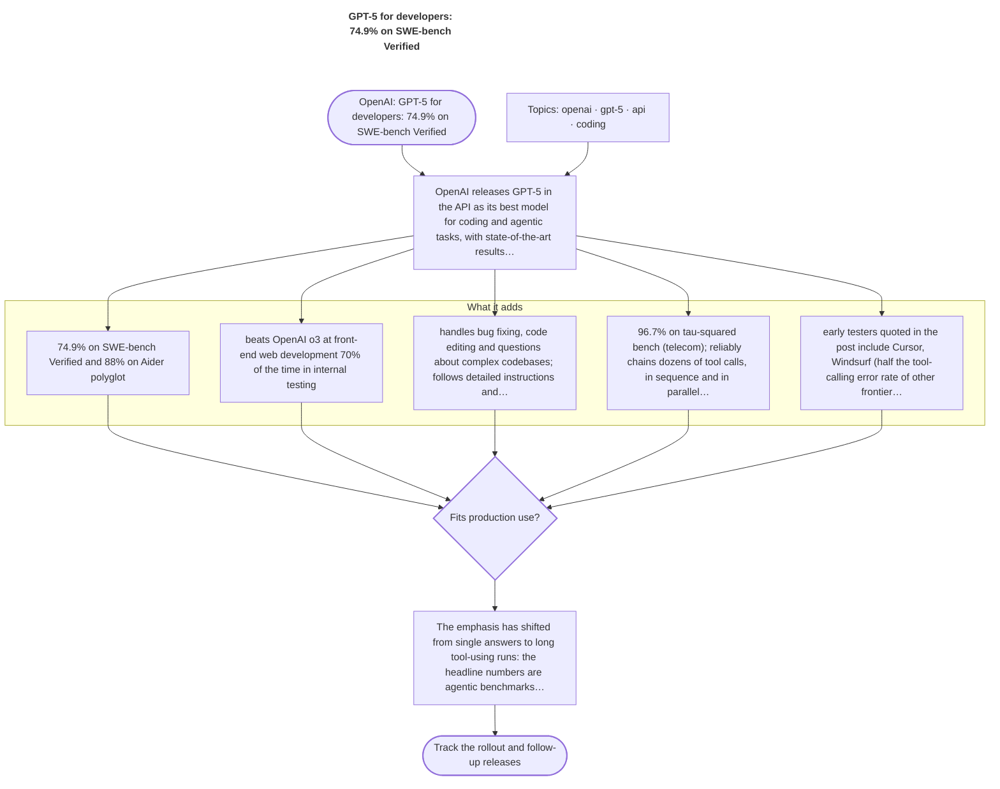

## What happened

On 7 August 2025 **OpenAI** released **GPT-5** in its API platform, describing it as its best model yet for coding and agentic tasks and trained to be a true coding collaborator.

## The technical details

From the OpenAI post:

- **74.9% on SWE-bench Verified** and **88% on Aider polyglot**
- beats OpenAI o3 at **front-end web development 70% of the time** in internal testing
- handles bug fixing, code editing and questions about complex codebases; follows detailed instructions and gives **upfront explanations** before and between tool calls
- **96.7% on tau-squared bench (telecom)**; reliably chains **dozens of tool calls**, in sequence and in parallel, without losing its way
- early testers quoted in the post include Cursor, Windsurf (half the tool-calling error rate of other frontier models) and Vercel

## How it fits together

The flowchart below maps this announcement's main points and what depends on them.

## Why it matters

The emphasis has shifted from single answers to long tool-using runs: the headline numbers are agentic benchmarks and the post stresses not losing the thread over many calls, which is the failure mode that limits coding agents.
