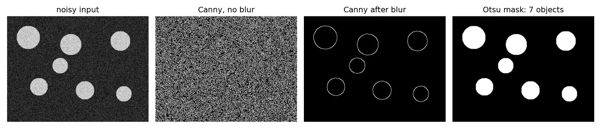

OpenCV is the classic image-processing toolbox. The operations I practised:

- `cv2.cvtColor`: RGB ↔ BGR ↔ GRAY ↔ HSV. OpenCV's own default order is **BGR**.
- `cv2.resize`: use `INTER_AREA` for shrinking and `INTER_LINEAR`/`CUBIC` for enlarging.
- `cv2.GaussianBlur`: smooths noise before further processing.
- `cv2.Canny`: edge detection with two hysteresis thresholds.
- `cv2.threshold` with Otsu's method picks a global threshold automatically.
- `cv2.findContours`: outlines of connected regions, useful for counting objects.

To get something countable, I drew a synthetic image of coins (circles) with noise added, so the expected answer is known: 7 objects.

```python run
import os
import cv2
import numpy as np
import matplotlib.pyplot as plt

rng = np.random.default_rng(0)
img = np.full((300, 400), 40, np.uint8)
centres = [(60, 60), (180, 80), (320, 70), (90, 200), (220, 210), (330, 220), (150, 140)]
for (x, y) in centres:
    cv2.circle(img, (x, y), int(rng.integers(22, 35)), 200, -1)
noisy = np.clip(img + rng.normal(0, 25, img.shape), 0, 255).astype(np.uint8)

blur = cv2.GaussianBlur(noisy, (7, 7), 0)
edges_raw = cv2.Canny(noisy, 50, 150)
edges = cv2.Canny(blur, 50, 150)
t, mask = cv2.threshold(blur, 0, 255, cv2.THRESH_BINARY + cv2.THRESH_OTSU)
contours, _ = cv2.findContours(mask, cv2.RETR_EXTERNAL, cv2.CHAIN_APPROX_SIMPLE)
print("edge pixels without blur:", int((edges_raw > 0).sum()), "| with blur:", int((edges > 0).sum()))
print("Otsu threshold:", t, "| objects found:", len(contours), "| expected:", len(centres))
print("resize 400x300 -> ", cv2.resize(noisy, (200, 150), interpolation=cv2.INTER_AREA).shape)

fig, axs = plt.subplots(1, 4, figsize=(13, 3), dpi=150)
for ax, im, title in zip(axs, [noisy, edges_raw, edges, mask], ["noisy input", "Canny, no blur", "Canny after blur", f"Otsu mask: {len(contours)} objects"]):
    ax.imshow(im, cmap="gray"); ax.set_title(title); ax.axis("off")
fig.tight_layout(); fig.savefig(os.environ["SNIPPET_FIG"])
```

Output:

```text
edge pixels without blur: 43137 | with blur: 1372
Otsu threshold: 117.0 | objects found: 7 | expected: 7
resize 400x300 ->  (150, 200)
```


