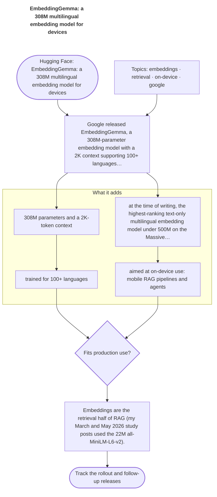

## What happened

**Google** released **EmbeddingGemma**, with integrations including Sentence Transformers, LangChain, LlamaIndex, Haystack, txtai, transformers.js, Text Embeddings Inference and ONNX Runtime, plus a fine-tuning example.

## The technical details

From the post:

- **308M** parameters and a **2K-token** context
- trained for **100+ languages**
- at the time of writing, the highest-ranking **text-only multilingual embedding model under 500M** on the **Massive Text Embedding Benchmark (MTEB)**
- aimed at **on-device** use: mobile RAG pipelines and agents

## How it fits together

The flowchart below maps this announcement's main points and what depends on them.

## Why it matters

Embeddings are the retrieval half of RAG (my March and May 2026 study posts used the 22M all-MiniLM-L6-v2). A stronger multilingual embedder that still runs on a phone makes private, on-device search more practical.
