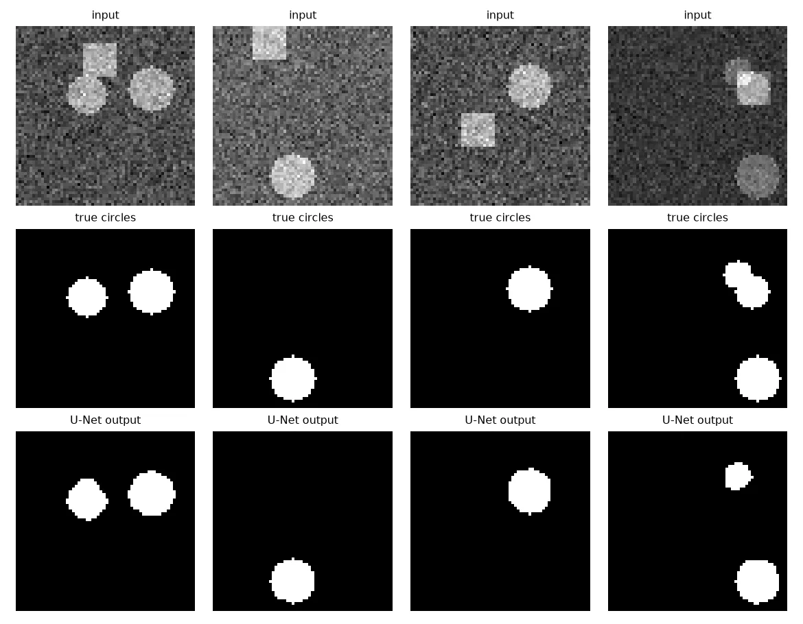

**Semantic segmentation** gives every pixel a class, so the output is a mask the same size as the image.

**U-Net** (Ronneberger, Fischer and Brox, 2015) was built for biomedical images with little training data:

- an **encoder** (convolutions + downsampling) captures *what* is in the image
- a **decoder** (upsampling + convolutions) restores *where*
- **skip connections** concatenate encoder feature maps into the decoder at the same resolution, which restores fine boundaries that downsampling loses

The overlap metrics are **IoU** and **Dice** = 2|A∩B| / (|A| + |B|).

My dataset is synthetic, so it runs on a CPU and the true masks are exact: random circles and squares on noise. The task is to segment the circles only.

```python run
import os
import numpy as np, torch, torch.nn as nn, torch.nn.functional as F
import matplotlib.pyplot as plt

torch.manual_seed(0); rng = np.random.default_rng(0); torch.set_num_threads(4)
def sample(n, S=64):
    X = rng.normal(0.2, 0.15, (n, 1, S, S)).astype(np.float32); Y = np.zeros((n, 1, S, S), np.float32)
    yy, xx = np.mgrid[:S, :S]
    for i in range(n):
        for _ in range(rng.integers(1, 4)):
            cx, cy, r = rng.integers(10, S - 10, 2).tolist() + [int(rng.integers(5, 10))]
            m = (xx - cx) ** 2 + (yy - cy) ** 2 <= r * r; X[i, 0][m] += 0.6; Y[i, 0][m] = 1
        x0, y0 = rng.integers(0, S - 14, 2); X[i, 0, y0:y0 + 12, x0:x0 + 12] += 0.6       # distractor square
    return torch.tensor(X), torch.tensor(Y)

def block(i, o): return nn.Sequential(nn.Conv2d(i, o, 3, padding=1), nn.ReLU(), nn.Conv2d(o, o, 3, padding=1), nn.ReLU())
class TinyUNet(nn.Module):
    def __init__(self):
        super().__init__()
        self.e1, self.e2, self.mid = block(1, 16), block(16, 32), block(32, 64)
        self.u2, self.d2 = nn.ConvTranspose2d(64, 32, 2, 2), block(64, 32)
        self.u1, self.d1 = nn.ConvTranspose2d(32, 16, 2, 2), block(32, 16)
        self.out = nn.Conv2d(16, 1, 1)
    def forward(self, x):
        e1 = self.e1(x); e2 = self.e2(F.max_pool2d(e1, 2)); m = self.mid(F.max_pool2d(e2, 2))
        d2 = self.d2(torch.cat([self.u2(m), e2], 1))          # skip connection
        d1 = self.d1(torch.cat([self.u1(d2), e1], 1))         # skip connection
        return self.out(d1)

net = TinyUNet(); opt = torch.optim.Adam(net.parameters(), lr=2e-3)
for step in range(400):
    x, y = sample(16)
    opt.zero_grad(); F.binary_cross_entropy_with_logits(net(x), y).backward(); opt.step()
x, y = sample(64)
with torch.no_grad():
    p = (torch.sigmoid(net(x)) > 0.5).float()
inter = (p * y).sum(); union = ((p + y) > 0).sum()
print("output shape:", tuple(p.shape), "| IoU", round((inter / union).item(), 3), "| Dice", round((2 * inter / (p.sum() + y.sum())).item(), 3))

fig, axs = plt.subplots(3, 4, figsize=(9, 7), dpi=130)
for j in range(4):
    for i, (im, t) in enumerate([(x[j, 0], "input"), (y[j, 0], "true circles"), (p[j, 0], "U-Net output")]):
        axs[i, j].imshow(im, cmap="gray"); axs[i, j].axis("off"); axs[i, j].set_title(t, fontsize=9)
fig.tight_layout(); fig.savefig(os.environ["SNIPPET_FIG"])
```

Output:

```text
output shape: (64, 1, 64, 64) | IoU 0.938 | Dice 0.968
```


