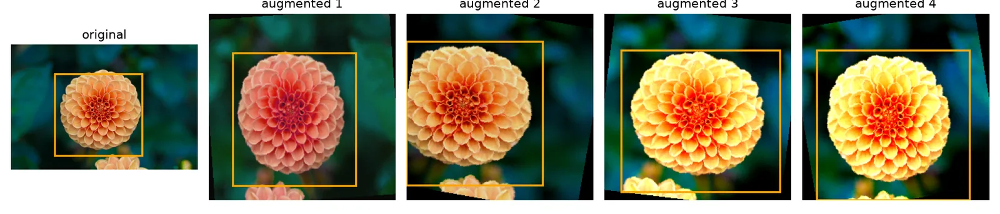

**Data augmentation** applies random, label-preserving transforms during training, so each epoch sees slightly different versions of each image. The model learns that a cat flipped or slightly darker is still a cat.

Common transforms, all in `torchvision.transforms.v2`:

- geometric: random resized crop, horizontal flip, small rotations
- photometric: colour jitter (brightness, contrast, saturation, hue)
- stronger ones: RandAugment, random erasing, MixUp/CutMix

Two rules:

1. Augment **only the training set**.
2. Keep the label valid. Flipping digits or text can change their meaning, and in detection the **boxes must move with the image**. The v2 transforms handle that when the boxes are wrapped as `tv_tensors.BoundingBoxes`.

```python run
import os
import torch
import matplotlib.pyplot as plt
from torchvision import tv_tensors
from torchvision.transforms import v2
from sklearn.datasets import load_sample_image

torch.manual_seed(0)
img = tv_tensors.Image(torch.from_numpy(load_sample_image("flower.jpg")).permute(2, 0, 1))
boxes = tv_tensors.BoundingBoxes([[150, 100, 450, 380]], format="XYXY", canvas_size=img.shape[-2:])

aug = v2.Compose([
    v2.RandomResizedCrop(size=(256, 256), scale=(0.5, 1.0), antialias=True),
    v2.RandomHorizontalFlip(p=0.5),
    v2.RandomRotation(degrees=15),
    v2.ColorJitter(brightness=0.4, contrast=0.4, saturation=0.4, hue=0.05),
])
fig, axs = plt.subplots(1, 5, figsize=(14, 3), dpi=130)
axs[0].imshow(img.permute(1, 2, 0)); axs[0].set_title("original"); axs[0].axis("off")
x1, y1, x2, y2 = boxes[0].tolist()
axs[0].add_patch(plt.Rectangle((x1, y1), x2 - x1, y2 - y1, fill=False, color="orange", lw=2))
for k in range(1, 5):
    out_img, out_box = aug(img, boxes)
    axs[k].imshow(out_img.permute(1, 2, 0)); axs[k].axis("off"); axs[k].set_title(f"augmented {k}")
    if len(out_box):
        bx1, by1, bx2, by2 = out_box[0].tolist()
        axs[k].add_patch(plt.Rectangle((bx1, by1), bx2 - bx1, by2 - by1, fill=False, color="orange", lw=2))
    print(f"view {k}: image {tuple(out_img.shape)}, box {[round(v) for v in out_box[0].tolist()] if len(out_box) else 'cropped out'}")
fig.tight_layout(); fig.savefig(os.environ["SNIPPET_FIG"])
```

Output:

```text
view 1: image (3, 256, 256), box [33, 54, 201, 236]
view 2: image (3, 256, 256), box [0, 38, 186, 235]
view 3: image (3, 256, 256), box [23, 50, 240, 244]
view 4: image (3, 256, 256), box [20, 50, 229, 255]
```



That completes computer vision. Next phase: Transformers, starting with "Attention Is All You Need".
