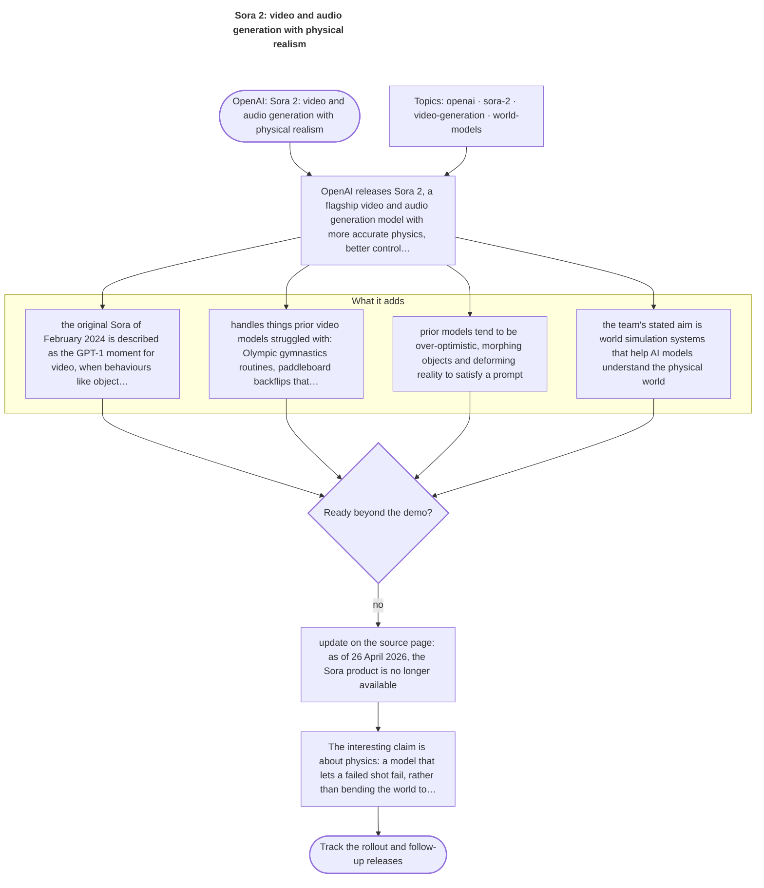

## What happened

On 30 September 2025 **OpenAI** released **Sora 2**, described as more physically accurate, realistic and controllable than earlier systems, with **synchronized dialogue and sound effects**, available in a new Sora app.

## The technical details

From the OpenAI post:

- the original Sora of February 2024 is described as the **GPT-1 moment for video**, when behaviours like object permanence first emerged from scaling; Sora 2 is framed as a jump to the **GPT-3.5 moment**
- handles things prior video models struggled with: **Olympic gymnastics routines**, **paddleboard backflips that model buoyancy and rigidity**, and triple axels
- prior models tend to be over-optimistic, **morphing objects and deforming reality** to satisfy a prompt
- the team's stated aim is world simulation systems that help AI models understand the physical world
- **update on the source page:** as of 26 April 2026, the Sora product is no longer available

## How it fits together

The flowchart below maps this announcement's main points and what depends on them.

## Why it matters

The interesting claim is about physics: a model that lets a failed shot fail, rather than bending the world to match the prompt, is closer to a simulator than a generator. That framing connects video models to the world-model research that Google DeepMind's Genie line also pursues.
