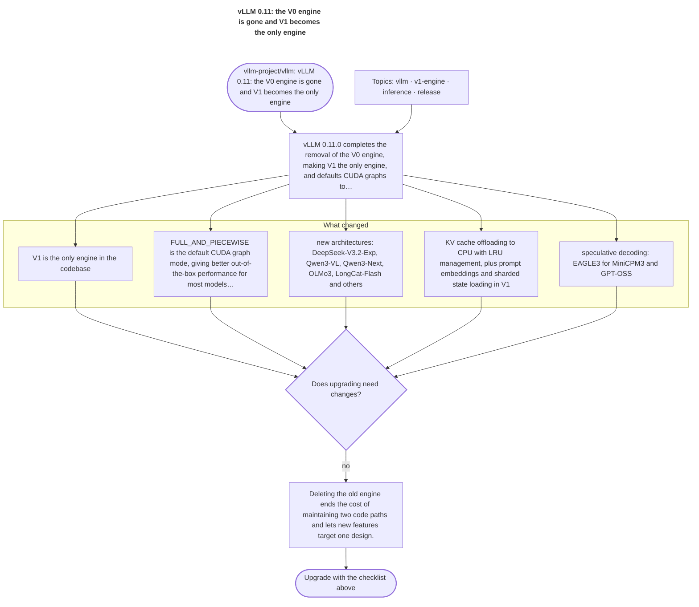

## What happened

On 2 October 2025 the **vLLM** project released **v0.11.0**, a release that finishes a long migration: the V0 engine code (AsyncLLMEngine, LLMEngine, MQLLMEngine and all attention backends) is removed.

## The technical details

From the release notes:

- **V1 is the only engine** in the codebase
- **FULL_AND_PIECEWISE** is the default CUDA graph mode, giving better out-of-the-box performance for most models, especially fine-grained MoEs, while staying compatible with models that support only PIECEWISE
- new architectures: **DeepSeek-V3.2-Exp, Qwen3-VL, Qwen3-Next, OLMo3, LongCat-Flash** and others
- **KV cache offloading** to CPU with LRU management, plus prompt embeddings and sharded state loading in V1
- speculative decoding: EAGLE3 for MiniCPM3 and GPT-OSS

## How it fits together

The flowchart below maps this announcement's main points and what depends on them.

## Why it matters

Deleting the old engine ends the cost of maintaining two code paths and lets new features target one design. The honest note about async scheduling shows that even a headline release can carry a known regression.
