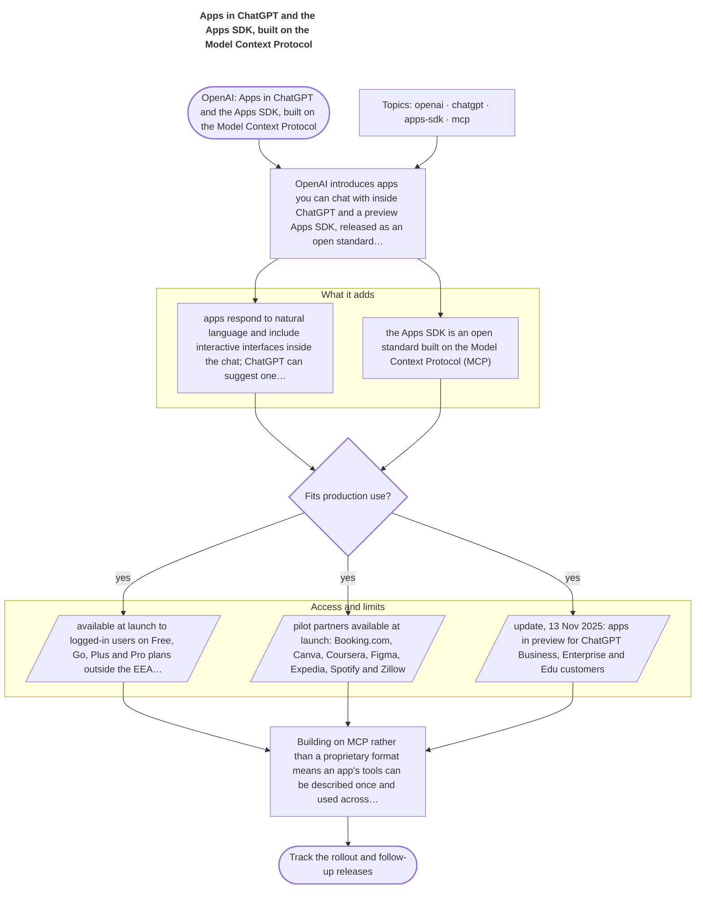

## What happened

On 6 October 2025 **OpenAI** introduced **apps in ChatGPT**, a new generation of apps you can chat with inside ChatGPT, together with the **Apps SDK** (preview) for developers. The post says the SDK gives developers a way to reach over 800 million ChatGPT users.

## The technical details

From the OpenAI post:

- apps **respond to natural language** and include **interactive interfaces** inside the chat; ChatGPT can suggest one at the right time, or you can call it by name
- the **Apps SDK** is an **open standard built on the Model Context Protocol (MCP)**
- available at launch to logged-in users on Free, Go, Plus and Pro plans **outside the EEA, Switzerland and the UK**
- pilot partners available at launch: **Booking.com, Canva, Coursera, Figma, Expedia, Spotify and Zillow**
- **update, 13 Nov 2025:** apps in preview for ChatGPT Business, Enterprise and Edu customers

## How it fits together

The flowchart below maps this announcement's main points and what depends on them.

## Why it matters

Building on MCP rather than a proprietary format means an app's tools can be described once and used across clients, which is the point of the protocol covered in this blog's November 2024 post. For OpenAI it positions ChatGPT as a surface that other services plug into rather than only a chat window.
