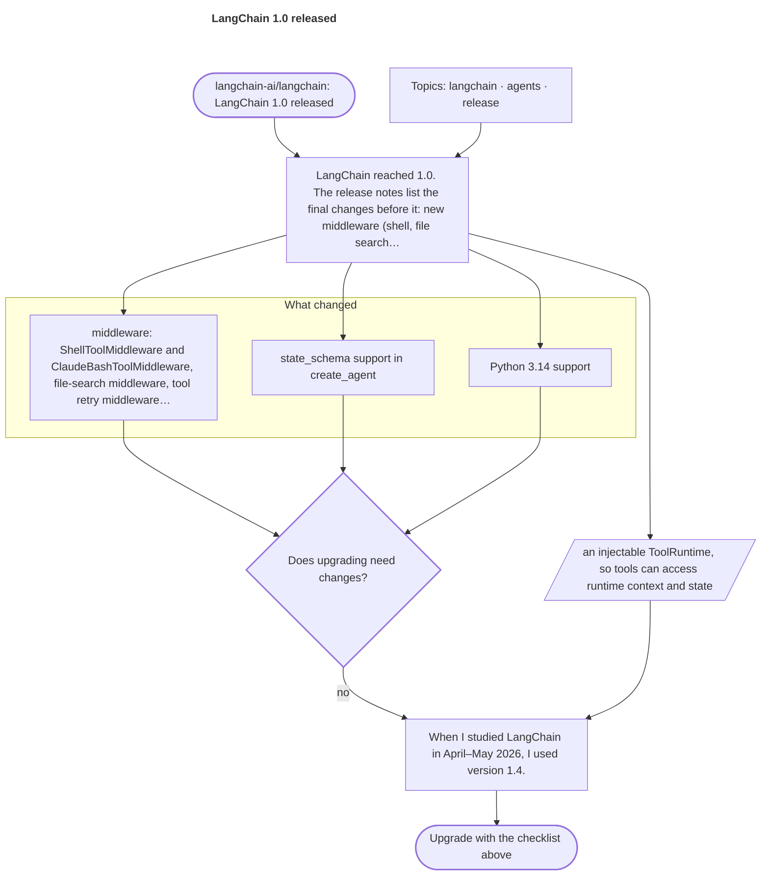

## What happened

**`langchain==1.0.0`** was released on GitHub, the same day as LangGraph 1.0.

## The technical details

The release notes are a list of changes since 0.3.27. The notable ones:

- **middleware**: `ShellToolMiddleware` and `ClaudeBashToolMiddleware`, **file-search** middleware, **tool retry** middleware, and model/tool call limits
- an injectable **`ToolRuntime`**, so tools can access runtime context and state
- `state_schema` support in **`create_agent`**
- **Python 3.14** support

## How it fits together

The flowchart below maps this announcement's main points and what depends on them.

## Why it matters

When I studied LangChain in April–May 2026, I used version 1.4. The 1.0 API is the base of what I learned: `create_agent` plus middleware around tool calls, with LangGraph underneath. These notes only list changes, so the design explanation is in LangChain's agent docs, linked above.
