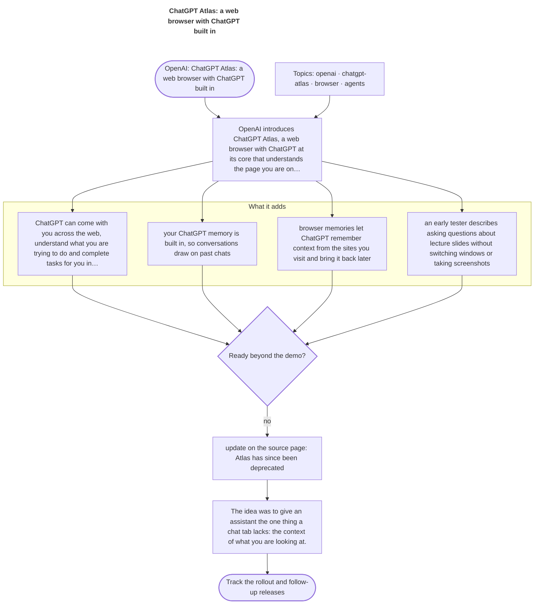

## What happened

On 21 October 2025 **OpenAI** introduced **ChatGPT Atlas**, a new web browser built with ChatGPT at its core. The post builds on ChatGPT search, which it calls one of its most-used features, and argues the browser is where work, tools and context come together.

## The technical details

From the OpenAI post:

- ChatGPT can **come with you across the web**, understand what you are trying to do and **complete tasks for you** in the page you are on
- your **ChatGPT memory is built in**, so conversations draw on past chats
- **browser memories** let ChatGPT remember context from the sites you visit and bring it back later
- an early tester describes asking questions about lecture slides without switching windows or taking screenshots
- **update on the source page:** Atlas has since been deprecated

## How it fits together

The flowchart below maps this announcement's main points and what depends on them.

## Why it matters

The idea was to give an assistant the one thing a chat tab lacks: the context of what you are looking at. The deprecation note is a useful reminder that product pages age quickly, which is why this post records both the launch and the later status.
