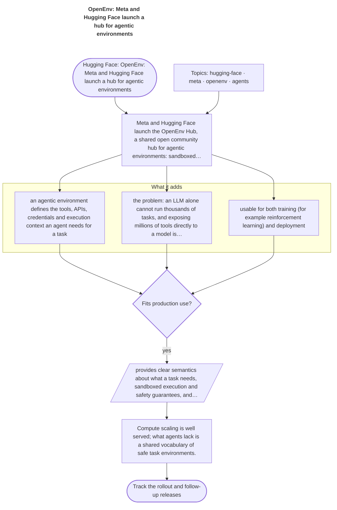

## What happened

On 23 October 2025 **Meta and Hugging Face** announced the **OpenEnv Hub**, a shared and open community hub for **agentic environments**, positioned alongside open-source tools like TRL, TorchForge and verl that scale AI across complex compute.

## The technical details

From the Hugging Face post:

- an **agentic environment** defines the **tools, APIs, credentials and execution context** an agent needs for a task
- provides **clear semantics** about what a task needs, **sandboxed execution and safety guarantees**, and **seamless access to authenticated tools and APIs**
- the problem: an LLM alone cannot run thousands of tasks, and **exposing millions of tools directly to a model is neither reasonable nor safe**
- usable for both **training** (for example reinforcement learning) and **deployment**

## How it fits together

The flowchart below maps this announcement's main points and what depends on them.

## Why it matters

Compute scaling is well served; what agents lack is a shared vocabulary of safe task environments. A common hub makes environments reusable between training and production, the same way datasets became shareable on the Hub.
