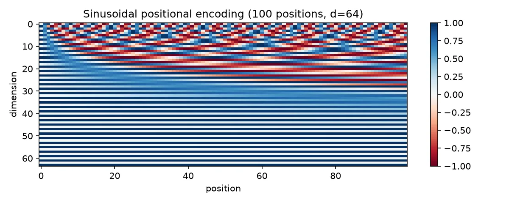

Self-attention is **permutation-equivariant**. If you shuffle the input tokens, the outputs shuffle the same way, so the model can't tell "dog bites man" from "man bites dog". Position has to be **added**.

The original paper adds a fixed **sinusoidal** encoding to the embeddings:

$$PE_{(pos,2i)} = \sin\!\left(\frac{pos}{10000^{2i/d}}\right), \qquad PE_{(pos,2i+1)} = \cos\!\left(\frac{pos}{10000^{2i/d}}\right)$$

Each dimension pair is a wave with a different frequency, so every position gets a unique pattern, and nearby positions get similar ones. Alternatives:

- **learned** position embeddings (BERT, GPT-2)
- **relative** methods such as **RoPE** (Su et al., 2021), which rotates queries and keys so their dot product depends on the *distance* between positions; many recent LLMs use it

I checked both claims: the permutation behaviour, and that sinusoidal encodings of nearby positions are more similar.

```python run
import os, math, torch
import matplotlib.pyplot as plt

def sinusoidal(n, d):
    pos = torch.arange(n).unsqueeze(1)
    div = torch.exp(torch.arange(0, d, 2) * (-math.log(10000.0) / d))
    pe = torch.zeros(n, d)
    pe[:, 0::2], pe[:, 1::2] = torch.sin(pos * div), torch.cos(pos * div)
    return pe

torch.manual_seed(0)
attn = torch.nn.MultiheadAttention(16, 2, batch_first=True)
x = torch.randn(1, 5, 16)
perm = torch.tensor([3, 0, 4, 1, 2])
out, _ = attn(x, x, x)
out_p, _ = attn(x[:, perm], x[:, perm], x[:, perm])
print("no positions -> output just shuffles:", torch.allclose(out[:, perm], out_p, atol=1e-6))

pe = sinusoidal(100, 64)
xp = x + pe[:5, :16]
out2, _ = attn(xp, xp, xp)
xpp = x[:, perm] + pe[:5, :16]
out2_p, _ = attn(xpp, xpp, xpp)
print("with positions -> no longer just shuffled:", not torch.allclose(out2[:, perm], out2_p, atol=1e-4))

cos = torch.nn.functional.cosine_similarity
print("similarity of pos 10 with pos 11, 20, 60:", [round(cos(pe[10], pe[j], dim=0).item(), 3) for j in (11, 20, 60)])

fig, ax = plt.subplots(figsize=(8, 3.2), dpi=150)
im = ax.imshow(pe.T, aspect="auto", cmap="RdBu")
ax.set_xlabel("position"); ax.set_ylabel("dimension"); ax.set_title("Sinusoidal positional encoding (100 positions, d=64)")
fig.colorbar(im, ax=ax); fig.tight_layout(); fig.savefig(os.environ["SNIPPET_FIG"])
```

Output:

```text
no positions -> output just shuffles: True
with positions -> no longer just shuffled: True
similarity of pos 10 with pos 11, 20, 60: [0.966, 0.658, 0.49]
```


