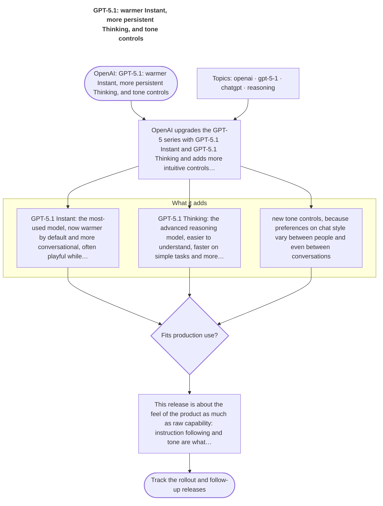

## What happened

On 12 November 2025 **OpenAI** released **GPT-5.1** in ChatGPT, rolling out to everyone beginning with paid users. The post says users wanted AI that is not only smart but enjoyable to talk to, and that 5.1 improves on both intelligence and communication style.

## The technical details

From the OpenAI post:

- **GPT-5.1 Instant:** the most-used model, now warmer by default and more conversational, often playful while staying clear
- **GPT-5.1 Thinking:** the advanced reasoning model, easier to understand, faster on simple tasks and more persistent on complex ones
- new **tone controls**, because preferences on chat style vary between people and even between conversations

## How it fits together

The flowchart below maps this announcement's main points and what depends on them.

## Why it matters

This release is about the feel of the product as much as raw capability: instruction following and tone are what users notice day to day. A separate developer release for GPT-5.1 followed the next day, as the feed shows.
