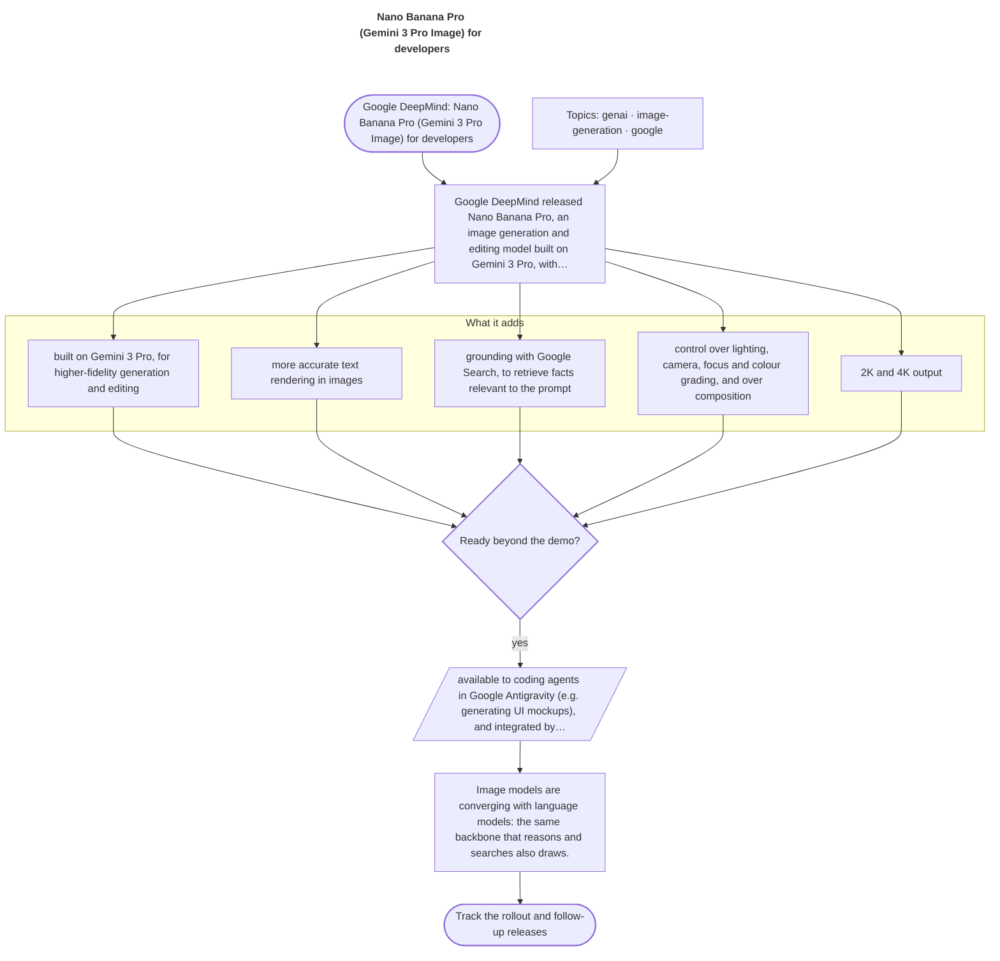

## What happened

Google DeepMind released **Nano Banana Pro (Gemini 3 Pro Image)** in paid preview through the Gemini API, Google AI Studio and Vertex AI. It follows Nano Banana (Gemini 2.5 Flash Image) from a few months earlier.

## The technical details

From the post:

- built on **Gemini 3 Pro**, for higher-fidelity generation and editing
- more accurate **text rendering** in images
- **grounding with Google Search**, to retrieve facts relevant to the prompt
- control over **lighting, camera, focus and colour grading**, and over composition
- **2K and 4K** output
- available to coding agents in **Google Antigravity** (e.g. generating UI mockups), and integrated by Adobe and Figma

## How it fits together

The flowchart below maps this announcement's main points and what depends on them.

## Why it matters

Image models are converging with language models: the same backbone that reasons and searches also draws. Text rendering, a classic weak point, is also what Qwen-Image targeted (August 2025 paper summary).
