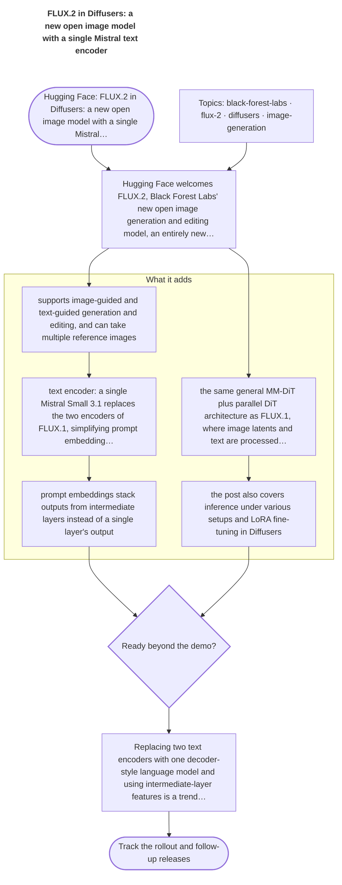

## What happened

On 25 November 2025 **Hugging Face** published its guide to **FLUX.2**, the new series of image generation models from **Black Forest Labs**. The post stresses that FLUX.2 is not a drop-in replacement for FLUX.1: it is a new model with a new architecture and pre-training done from scratch.

## The technical details

From the Hugging Face post:

- supports **image-guided and text-guided generation and editing**, and can take **multiple reference images**
- **text encoder:** a single **Mistral Small 3.1** replaces the two encoders of FLUX.1, simplifying prompt embedding; max sequence length 512
- prompt embeddings **stack outputs from intermediate layers** instead of a single layer's output
- the same general **MM-DiT plus parallel DiT** architecture as FLUX.1, where image latents and text are processed in separate streams and joined only for attention
- the post also covers inference under various setups and LoRA fine-tuning in Diffusers

## How it fits together

The flowchart below maps this announcement's main points and what depends on them.

## Why it matters

Replacing two text encoders with one decoder-style language model and using intermediate-layer features is a trend visible across recent open image models, because it makes prompts richer without an extra encoder to manage.
