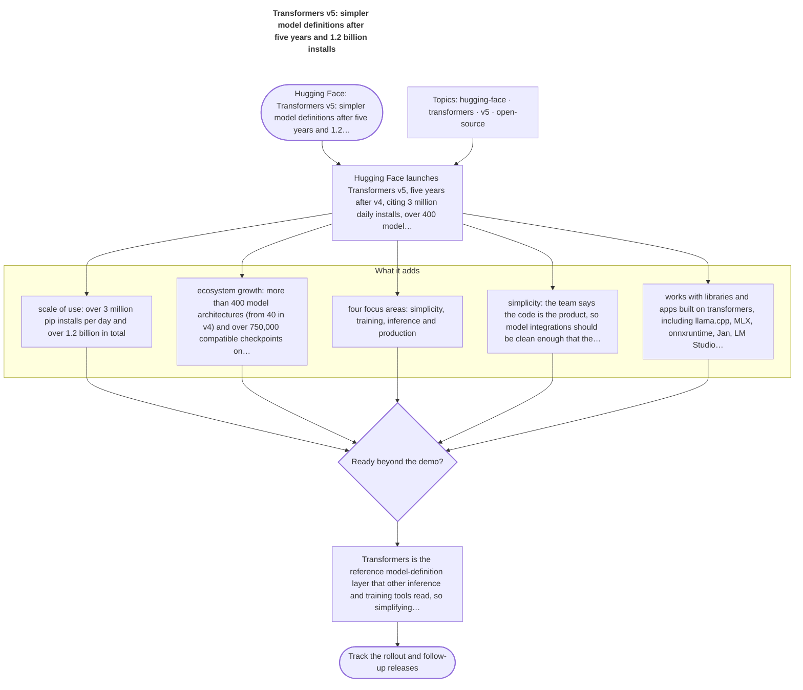

## What happened

On 1 December 2025 **Hugging Face** announced **Transformers v5** (a release candidate, v5.0.0rc-0), five years after the first v4 release candidate on 19 November 2020. The post argues that reinvention is key for longevity in AI.

## The technical details

From the Hugging Face post:

- **scale of use:** over 3 million pip installs per day and over 1.2 billion in total
- **ecosystem growth:** more than 400 model architectures (from 40 in v4) and over 750,000 compatible checkpoints on the Hub (from about 1,000)
- four focus areas: **simplicity, training, inference and production**
- **simplicity:** the team says the code is the product, so model integrations should be clean enough that the ecosystem can depend on and understand them
- works with libraries and apps built on transformers, including **llama.cpp, MLX, onnxruntime, Jan, LM Studio, vLLM, SGLang, Unsloth and LlamaFactory**

## How it fits together

The flowchart below maps this announcement's main points and what depends on them.

## Why it matters

Transformers is the reference model-definition layer that other inference and training tools read, so simplifying it spreads to everything downstream. The release is also the foundation for the 5.x feature releases that followed through 2026.
