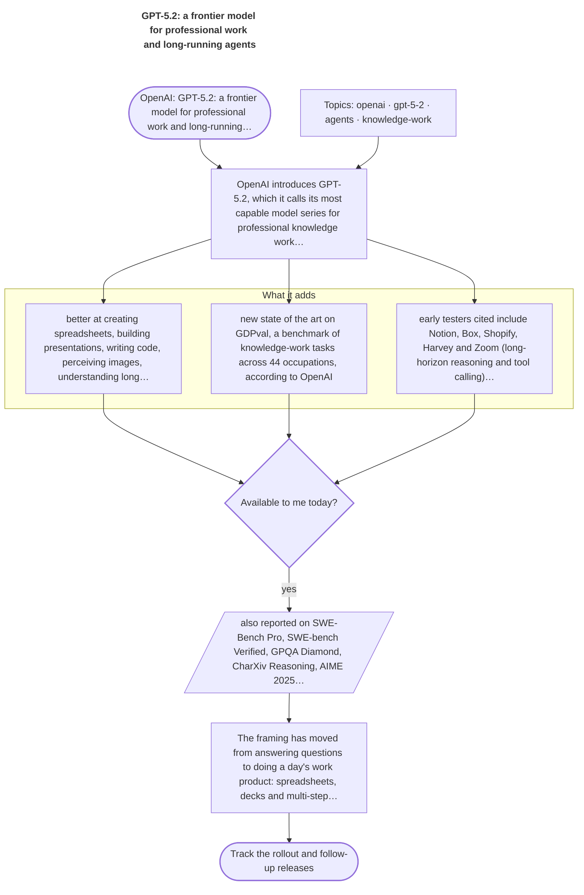

## What happened

On 11 December 2025 **OpenAI** introduced **GPT-5.2**, which it describes as the most advanced frontier model for professional work and long-running agents.

## The technical details

From the OpenAI post:

- better at **creating spreadsheets, building presentations, writing code, perceiving images, understanding long contexts, using tools** and handling complex multi-step projects
- new state of the art on **GDPval**, a benchmark of knowledge-work tasks across **44 occupations**, according to OpenAI
- also reported on SWE-Bench Pro, SWE-bench Verified, GPQA Diamond, CharXiv Reasoning, AIME 2025, FrontierMath (Tiers 1 to 3 and Tier 4) and ARC-AGI-1 and 2
- early testers cited include Notion, Box, Shopify, Harvey and Zoom (long-horizon reasoning and tool calling) and Databricks, Hex and Triple Whale

## How it fits together

The flowchart below maps this announcement's main points and what depends on them.

## Why it matters

The framing has moved from answering questions to doing a day's work product: spreadsheets, decks and multi-step projects. The post justifies this with usage data (time saved per day) rather than only benchmark scores.
