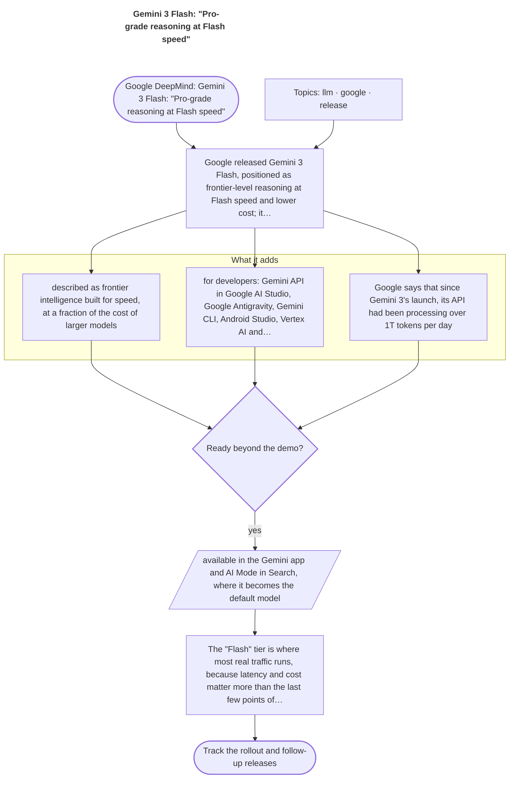

## What happened

Google released **Gemini 3 Flash**, expanding the Gemini 3 family a month after Gemini 3 Pro and Gemini 3 Deep Think.

## The technical details

From the post:

- described as **frontier intelligence built for speed**, at a fraction of the cost of larger models
- available in the **Gemini app** and **AI Mode in Search**, where it becomes the default model
- for developers: Gemini API in Google AI Studio, Google Antigravity, Gemini CLI, Android Studio, Vertex AI and Gemini Enterprise
- Google says that since Gemini 3's launch, its API had been processing **over 1T tokens per day**

## How it fits together

The flowchart below maps this announcement's main points and what depends on them.

## Why it matters

The "Flash" tier is where most real traffic runs, because latency and cost matter more than the last few points of quality. Later Flash releases here (3.5 in May, 3.7 in August 2026) continue the pattern.
