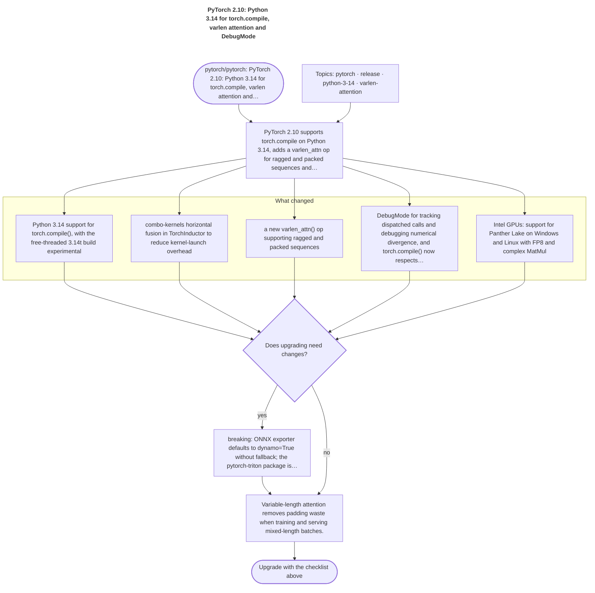

## What happened

On 21 January 2026 the **PyTorch** team released **2.10.0**.

## The technical details

From the release notes:

- **Python 3.14** support for `torch.compile()`, with the free-threaded **3.14t** build experimental
- **combo-kernels horizontal fusion** in TorchInductor to reduce kernel-launch overhead
- a new **`varlen_attn()`** op supporting ragged and packed sequences
- **`DebugMode`** for tracking dispatched calls and debugging numerical divergence, and `torch.compile()` now respects `use_deterministic_mode`
- **Intel GPUs:** support for Panther Lake on Windows and Linux with FP8 and complex MatMul
- breaking: **ONNX exporter** defaults to `dynamo=True` without fallback; the `pytorch-triton` package is renamed `triton`

## How it fits together

The flowchart below maps this announcement's main points and what depends on them.

## Why it matters

Variable-length attention removes padding waste when training and serving mixed-length batches. DebugMode targets a pain point of large-model work: finding where two runs first diverge numerically.
