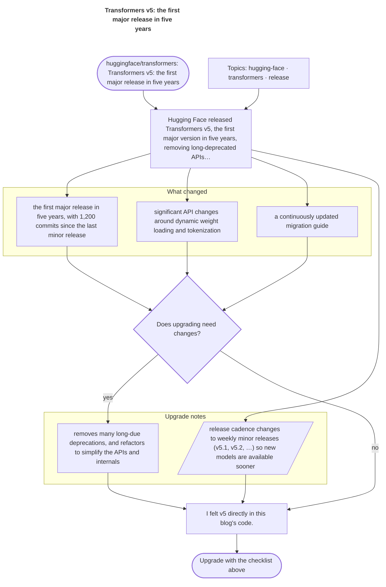

## What happened

**Transformers v5.0.0** was released.

## The technical details

From the release notes:

- the **first major release in five years**, with **1,200 commits** since the last minor release
- removes many **long-due deprecations**, and refactors to simplify the APIs and internals
- significant API changes around **dynamic weight loading** and **tokenization**
- a continuously updated **migration guide**
- release cadence changes to **weekly minor releases** (v5.1, v5.2, …) so new models are available sooner

## How it fits together

The flowchart below maps this announcement's main points and what depends on them.

## Why it matters

I felt v5 directly in this blog's code. `apply_chat_template(..., return_tensors="pt")` now returns a dict-like object instead of a tensor, so my tool-calling and prompting snippets had to use `return_dict=True` and `["input_ids"]`. Models now print a load report too. Major versions break things, and the migration guide is the first place to look.
