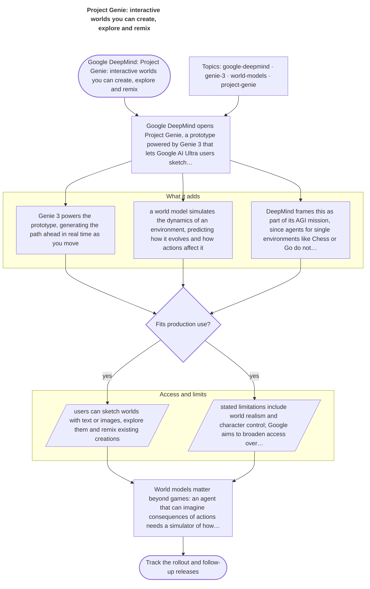

## What happened

On 29 January 2026 **Google DeepMind** announced **Project Genie**, a dedicated interactive prototype for immersive world creation, available to Google AI Ultra users. It follows the August preview of **Genie 3**, a general-purpose world model that generates diverse, interactive environments.

## The technical details

From the Google DeepMind post:

- users can **sketch worlds with text or images, explore them and remix** existing creations
- **Genie 3** powers the prototype, generating the path ahead in real time as you move
- a **world model** simulates the dynamics of an environment, predicting how it evolves and how actions affect it
- DeepMind frames this as part of its AGI mission, since agents for single environments like Chess or Go do not capture the diversity of the real world
- stated limitations include world realism and character control; Google aims to broaden access over time

## How it fits together

The flowchart below maps this announcement's main points and what depends on them.

## Why it matters

World models matter beyond games: an agent that can imagine consequences of actions needs a simulator of how environments respond. Making Genie 3 a hands-on prototype is the step from research preview to something people can test.
