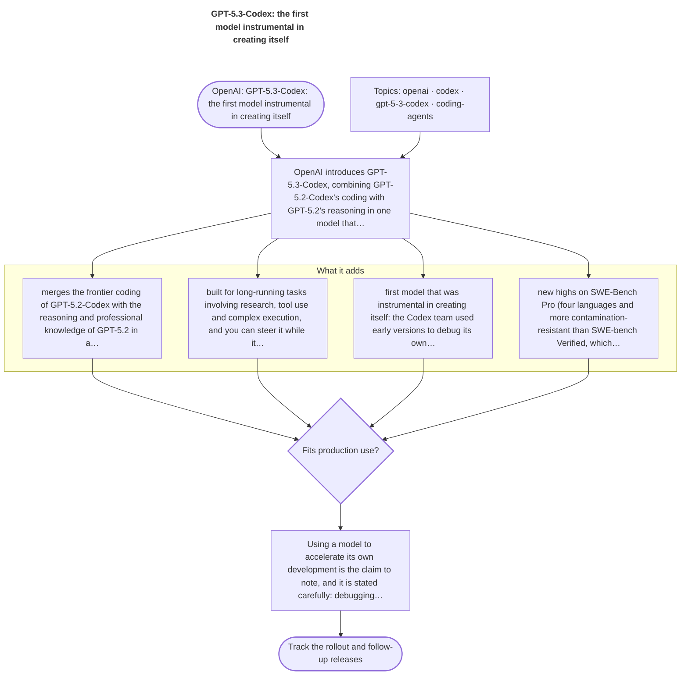

## What happened

On 5 February 2026 **OpenAI** introduced **GPT-5.3-Codex**, described as its most capable agentic coding model, expanding Codex across the full spectrum of professional work on a computer.

## The technical details

From the OpenAI post:

- merges the **frontier coding** of GPT-5.2-Codex with the **reasoning and professional knowledge** of GPT-5.2 in a single model, **25% faster**
- built for **long-running tasks** involving research, tool use and complex execution, and you can **steer it while it works** without losing context
- **first model that was instrumental in creating itself:** the Codex team used early versions to debug its own training, manage its own deployment and diagnose test and evaluation results
- new highs on **SWE-Bench Pro** (four languages and more contamination-resistant than SWE-bench Verified, which tests only Python) and **Terminal-Bench**, with strong results on **OSWorld** and **GDPval**

## How it fits together

The flowchart below maps this announcement's main points and what depends on them.

## Why it matters

Using a model to accelerate its own development is the claim to note, and it is stated carefully: debugging training, managing deployment and reading evals, not designing itself. The benchmark choice also matters: SWE-Bench Pro is multi-language, addressing the criticism that Verified measures only Python.
