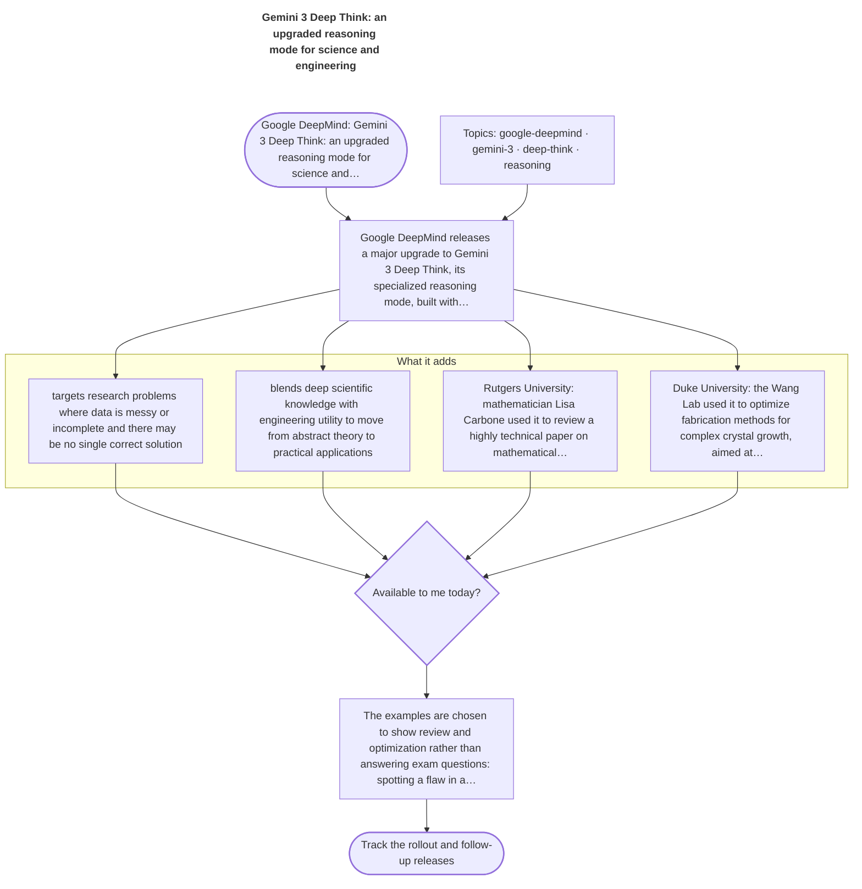

## What happened

On 12 February 2026 **Google DeepMind** released a major upgrade to **Gemini 3 Deep Think**, its most specialized reasoning mode, aimed at modern challenges across science, research and engineering.

## The technical details

From the Google DeepMind post:

- targets research problems where **data is messy or incomplete** and there may be no single correct solution
- blends **deep scientific knowledge with engineering utility** to move from abstract theory to practical applications
- **Rutgers University:** mathematician Lisa Carbone used it to review a highly technical paper on mathematical structures for high-energy physics, and it identified a **subtle logical flaw that had passed peer review**
- **Duke University:** the Wang Lab used it to optimize fabrication methods for complex crystal growth, aimed at discovering potential semiconductor materials

## How it fits together

The flowchart below maps this announcement's main points and what depends on them.

## Why it matters

The examples are chosen to show review and optimization rather than answering exam questions: spotting a flaw in a paper, tuning a lab process. The post attributes both outcomes to named early testers, which is the evidence to look for in such claims.
