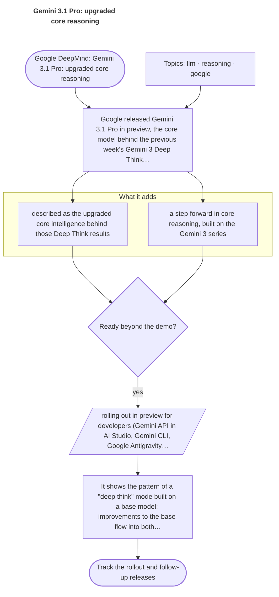

## What happened

Google released **Gemini 3.1 Pro**, a week after a major **Gemini 3 Deep Think** update for science, research and engineering.

## The technical details

From the post:

- described as the **upgraded core intelligence** behind those Deep Think results
- a **step forward in core reasoning**, built on the Gemini 3 series
- rolling out **in preview** for developers (Gemini API in AI Studio, Gemini CLI, Google Antigravity, Android Studio), enterprises (Vertex AI, Gemini Enterprise) and consumers (Gemini app, NotebookLM)

## How it fits together

The flowchart below maps this announcement's main points and what depends on them.

## Why it matters

It shows the pattern of a "deep think" mode built on a base model: improvements to the base flow into both everyday use and the slower reasoning mode. The post's specific benchmark tables aren't reproduced here.
