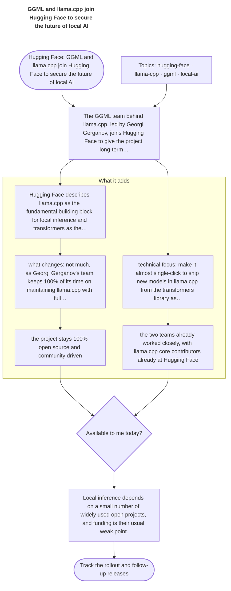

## What happened

On 20 February 2026 **Hugging Face** announced that **GGML**, the creators of llama.cpp, are joining the company, with the goal of scaling and supporting the community behind ggml and llama.cpp as local AI continues to progress.

## The technical details

From the Hugging Face post:

- Hugging Face describes **llama.cpp as the fundamental building block for local inference** and **transformers as the fundamental building block for model definition**
- **what changes: not much**, as Georgi Gerganov's team keeps 100% of its time on maintaining llama.cpp with full autonomy; Hugging Face provides long-term sustainable resources
- the project **stays 100% open source and community driven**
- **technical focus:** make it almost single-click to ship new models in llama.cpp from the transformers library as the source of truth for model definitions
- the two teams already worked closely, with llama.cpp core contributors already at Hugging Face

## How it fits together

The flowchart below maps this announcement's main points and what depends on them.

## Why it matters

Local inference depends on a small number of widely used open projects, and funding is their usual weak point. Pairing llama.cpp with transformers also removes a recurring gap: a new model's architecture had to be reimplemented for local runners after release.
