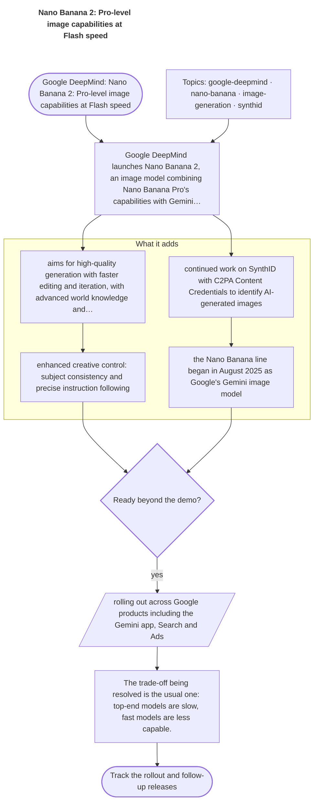

## What happened

On 26 February 2026 **Google DeepMind** launched **Nano Banana 2**, a new image model combining the advanced features of **Nano Banana Pro** with the speed of **Gemini Flash**.

## The technical details

From the Google DeepMind post:

- aims for **high-quality generation with faster editing and iteration**, with advanced world knowledge and production-ready specs
- **enhanced creative control**: subject consistency and precise instruction following
- rolling out across Google products including the **Gemini app, Search and Ads**
- continued work on **SynthID** with **C2PA Content Credentials** to identify AI-generated images
- the Nano Banana line began in August 2025 as Google's Gemini image model

## How it fits together

The flowchart below maps this announcement's main points and what depends on them.

## Why it matters

The trade-off being resolved is the usual one: top-end models are slow, fast models are less capable. Putting Pro-level features at Flash speed matters because image editing is iterative, and latency decides how many tries a person will make.
