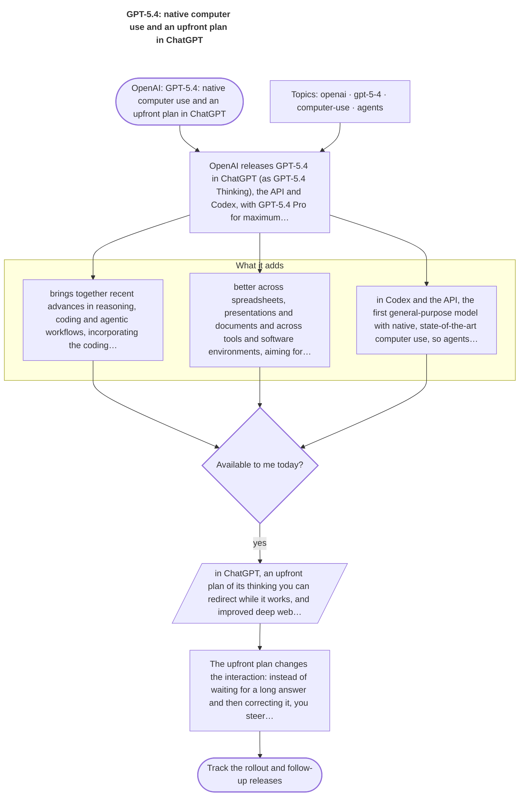

## What happened

On 5 March 2026 **OpenAI** released **GPT-5.4**, its most capable and efficient frontier model for professional work, in ChatGPT as **GPT-5.4 Thinking**, in the API and in Codex, plus **GPT-5.4 Pro** for complex tasks.

## The technical details

From the OpenAI post:

- brings together recent advances in **reasoning, coding and agentic workflows**, incorporating the coding capabilities of GPT-5.3-Codex
- better across **spreadsheets, presentations and documents** and across tools and software environments, aiming for less back-and-forth
- in ChatGPT, an **upfront plan of its thinking** you can redirect while it works, and improved **deep web research** for specific queries
- in Codex and the API, the **first general-purpose model with native, state-of-the-art computer use**, so agents can operate computers across applications; the feed description also mentions tool search and a 1M-token context

## How it fits together

The flowchart below maps this announcement's main points and what depends on them.

## Why it matters

The upfront plan changes the interaction: instead of waiting for a long answer and then correcting it, you steer the work mid-flight. Native computer use folds into a general model what used to need a specialized agent such as Operator.
