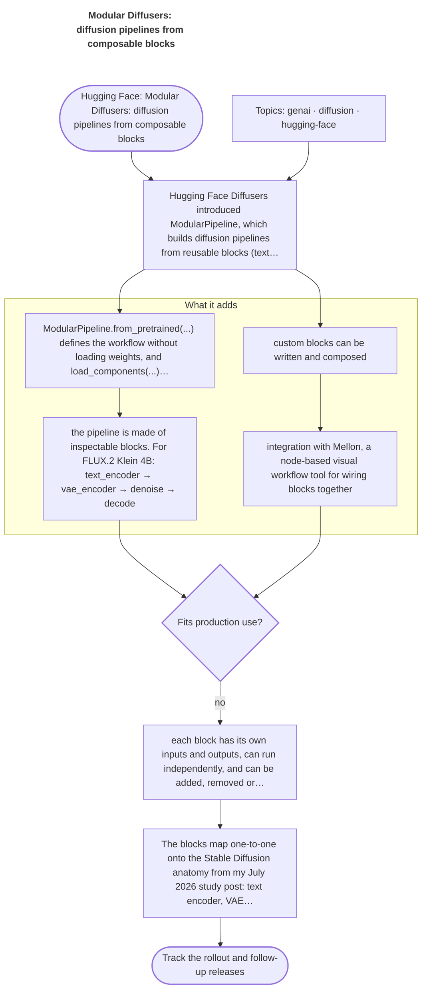

## What happened

Hugging Face introduced **Modular Diffusers**, a composable alternative to the classic `DiffusionPipeline`.

## The technical details

From the post:

- `ModularPipeline.from_pretrained(...)` **defines the workflow without loading weights**, and `load_components(...)` loads them, with dtype and quantisation settings
- the pipeline is made of inspectable **blocks**. For FLUX.2 Klein 4B: `text_encoder` → `vae_encoder` → `denoise` → `decode`
- each block has its own inputs and outputs, can **run independently**, and can be **added, removed or swapped**
- custom blocks can be written and composed
- integration with **Mellon**, a node-based visual workflow tool for wiring blocks together

## How it fits together

The flowchart below maps this announcement's main points and what depends on them.

## Why it matters

The blocks map one-to-one onto the Stable Diffusion anatomy from my July 2026 study post: text encoder, VAE, denoiser, decoder. Making them explicit turns "a pipeline" into something you can debug and remix.
