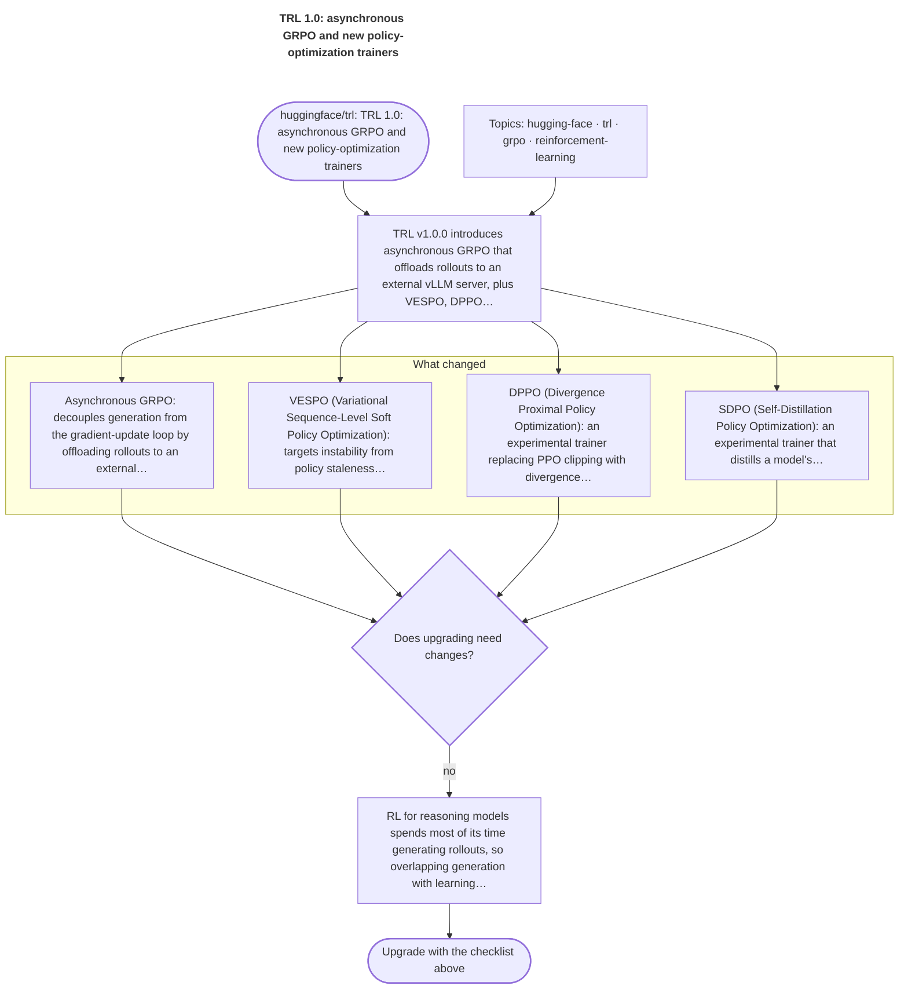

## What happened

On 31 March 2026 **Hugging Face** released **TRL v1.0.0**, the first major version of its post-training library, with a companion blog post titled “TRL v1: Post-Training Library Built to Move with the Field”.

## The technical details

From the release notes:

- **Asynchronous GRPO:** decouples generation from the gradient-update loop by **offloading rollouts to an external vLLM server**, so generation and training run in parallel and hardware is used better
- **VESPO** (Variational Sequence-Level Soft Policy Optimization): targets instability from **policy staleness, asynchronous updates and train-inference mismatch** with a smooth asymmetric Gamma weighting of extreme sequence-level importance weights, enabled with `loss_type="vespo"` in `GRPOConfig`
- **DPPO** (Divergence Proximal Policy Optimization): an experimental trainer replacing PPO clipping with divergence constraints for trust-region updates
- **SDPO** (Self-Distillation Policy Optimization): an experimental trainer that distills a model's feedback-informed predictions on its own high-reward trajectories back into the policy

## How it fits together

The flowchart below maps this announcement's main points and what depends on them.

## Why it matters

RL for reasoning models spends most of its time generating rollouts, so overlapping generation with learning attacks the main cost. The new trainers address the other practical issue, which is stability when the sampling policy lags the training policy.
