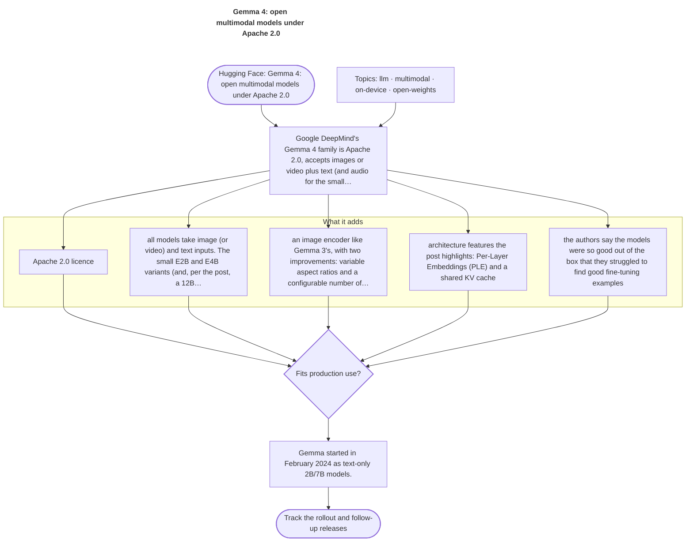

## What happened

**Gemma 4** was released, with support across Transformers, llama.cpp, MLX, WebGPU/transformers.js, Mistral.rs and fine-tuning with TRL and Unsloth.

## The technical details

From the Hugging Face post:

- **Apache 2.0** licence
- all models take **image (or video) and text** inputs. The small **E2B and E4B** variants (and, per the post, a 12B Unified model) also take **audio**.
- an image encoder like Gemma 3's, with two improvements: **variable aspect ratios** and a **configurable number of image tokens** (trading speed and memory against quality)
- architecture features the post highlights: **Per-Layer Embeddings (PLE)** and a **shared KV cache**
- the authors say the models were so good out of the box that they struggled to find good fine-tuning examples

## How it fits together

The flowchart below maps this announcement's main points and what depends on them.

## Why it matters

Gemma started in February 2024 as text-only 2B/7B models. Two years later it's multimodal with audio, efficient enough for devices, and permissively licensed.
