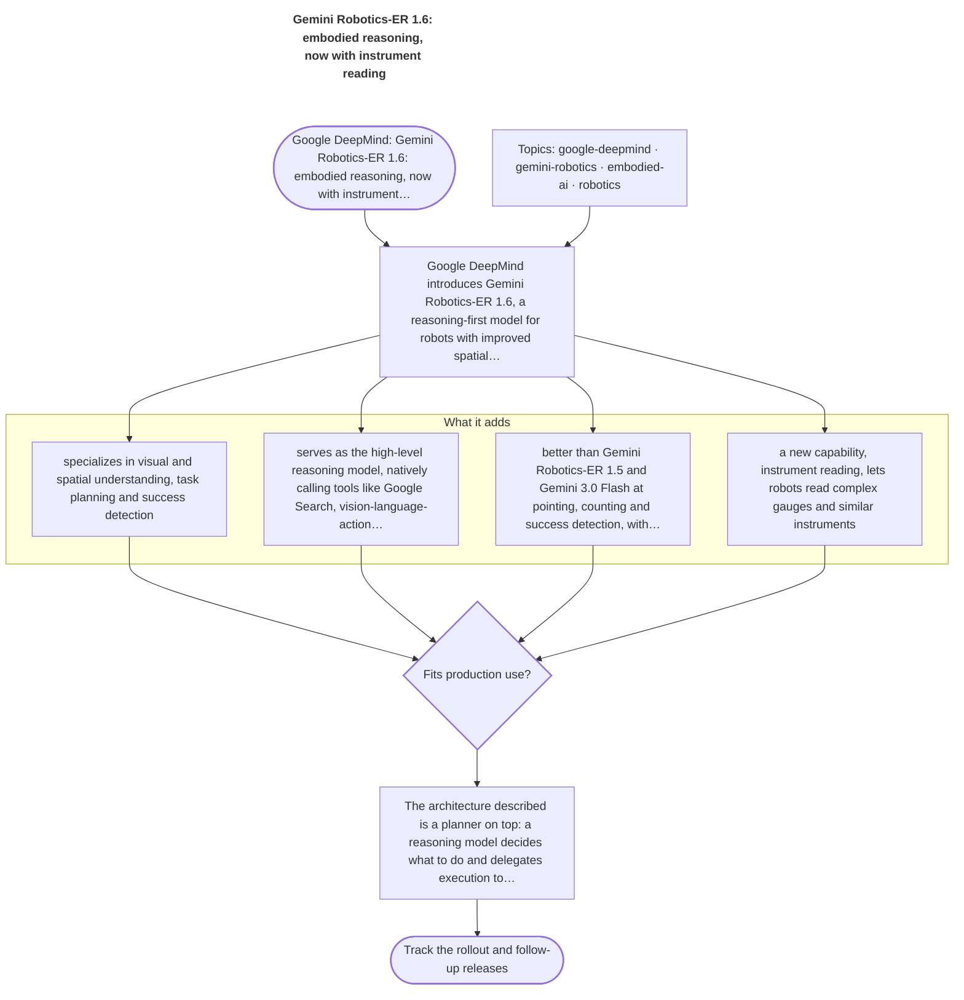

## What happened

On 13 April 2026 **Google DeepMind** introduced **Gemini Robotics-ER 1.6**, a significant upgrade to its reasoning-first model for robots. The post argues that robots must do more than follow instructions: they need embodied reasoning to bridge digital intelligence and physical action, from navigating a facility to reading a pressure gauge.

## The technical details

From the Google DeepMind post:

- specializes in **visual and spatial understanding, task planning and success detection**
- serves as the **high-level reasoning model**, natively calling tools like **Google Search**, **vision-language-action (VLA) models** or any third-party function
- better than Gemini Robotics-ER 1.5 and Gemini 3.0 Flash at **pointing, counting and success detection**, with stronger **multi-view understanding**
- a new capability, **instrument reading**, lets robots read complex gauges and similar instruments

## How it fits together

The flowchart below maps this announcement's main points and what depends on them.

## Why it matters

The architecture described is a planner on top: a reasoning model decides what to do and delegates execution to low-level policies or tools. Success detection and instrument reading are the unglamorous skills that let a robot know whether a task actually finished.
