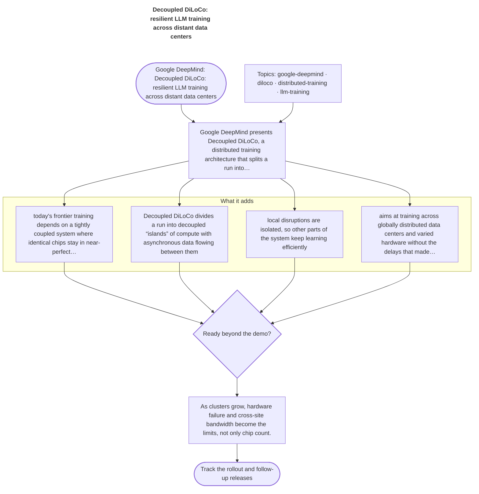

## What happened

On 22 April 2026 **Google DeepMind** shared a new paper on **Decoupled DiLoCo** (Distributed Low-Communication), an approach to training large models across distant data centers with lower bandwidth and more hardware resiliency. The post is by Arthur Douillard and the DiLoCo team.

## The technical details

From the Google DeepMind post:

- today's frontier training depends on a **tightly coupled system** where identical chips stay in near-perfect synchronization, which becomes a logistical challenge at larger scale
- Decoupled DiLoCo divides a run into **decoupled “islands” of compute** with **asynchronous data** flowing between them
- **local disruptions are isolated**, so other parts of the system keep learning efficiently
- aims at training across **globally distributed data centers** and varied hardware without the delays that made earlier data-parallel approaches impractical

## How it fits together

The flowchart below maps this announcement's main points and what depends on them.

## Why it matters

As clusters grow, hardware failure and cross-site bandwidth become the limits, not only chip count. Asynchronous islands trade strict synchronization for resilience, and this blog's study notes on distributed training (FSDP, ZeRO, checkpointing) describe the synchronous baseline this approach departs from.
