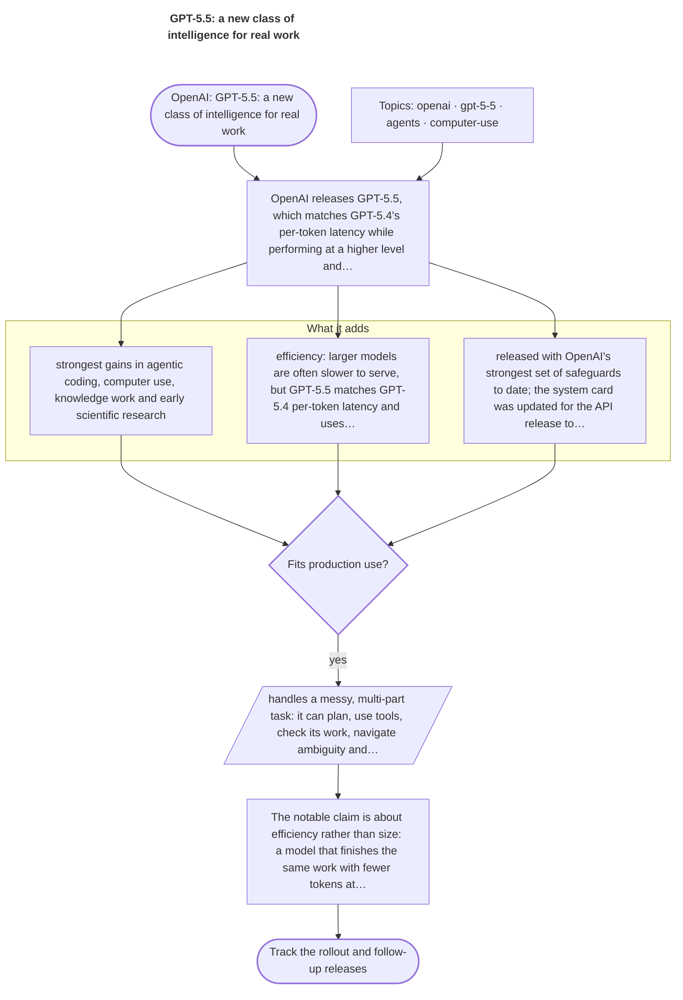

## What happened

On 23 April 2026 **OpenAI** released **GPT-5.5**, calling it its smartest and most intuitive model yet and the next step toward a new way of getting work done on a computer. On 24 April it became available in the API, as did GPT-5.5 Pro.

## The technical details

From the OpenAI post:

- handles a messy, multi-part task: it can **plan, use tools, check its work, navigate ambiguity and keep going**
- strongest gains in **agentic coding, computer use, knowledge work and early scientific research**
- **efficiency:** larger models are often slower to serve, but GPT-5.5 matches GPT-5.4 **per-token latency** and uses **significantly fewer tokens** on the same Codex tasks
- released with OpenAI's **strongest set of safeguards to date**; the system card was updated for the API release to describe additional safeguards

## How it fits together

The flowchart below maps this announcement's main points and what depends on them.

## Why it matters

The notable claim is about efficiency rather than size: a model that finishes the same work with fewer tokens at the same speed lowers cost and latency together, which is what makes agent loops affordable.
